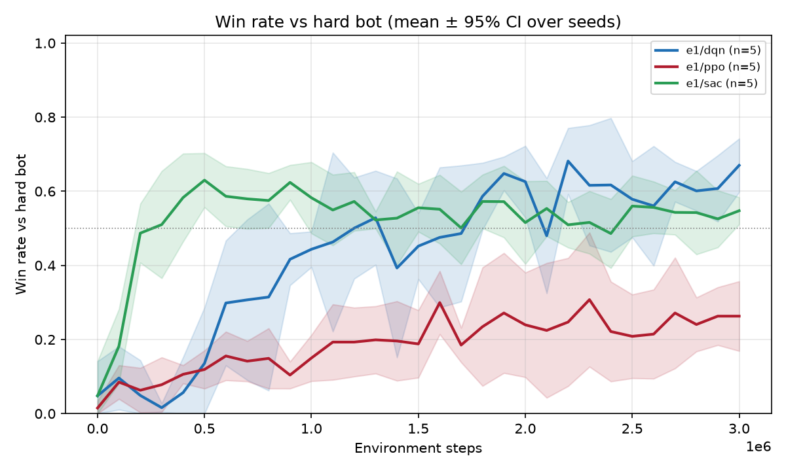
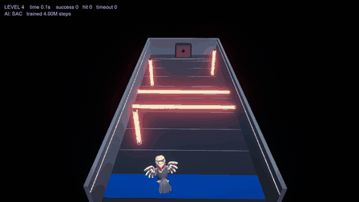

# 알바트로스 배구: 강화학습 알고리즘 대결

서강대 마스코트 알바트로스를 모티브로 한 2D 1:1 배구 게임을 직접 만들고, 직접 구현한 PPO·DQN·SAC 에이전트를 같은 조건에서 학습시킨 뒤 리그전으로 비교하는 강화학습 기말 프로젝트다.

- 환경: 외부 물리 엔진 없이 직접 구현한 배구 게임 (이동, 점프, 스파이크, 다이빙)
- 알고리즘: PPO, Double DQN, 이산 SAC를 PyTorch로 직접 구현
- 비교: 같은 학습 스텝, 같은 상대, 같은 평가. seed 5개와 95% 신뢰구간

> 현재 상태: 본 실험(8개 실험, 학습 80회) 완료. 결과는 [실험 결과](docs/results.md)에 있다.

## 설치

Python 3.10 이상. 가상환경을 만들어서 쓴다.

```powershell
python -m venv .venv
.venv\Scripts\Activate.ps1          # macOS/Linux: source .venv/bin/activate
pip install -r requirements.txt
```

이후 명령은 모두 가상환경을 켠 상태에서 실행한다. PowerShell에서 스크립트 실행이 막혀 있으면 `Set-ExecutionPolicy -Scope Process RemoteSigned`를 먼저 실행하거나, `.venv\Scripts\python`으로 직접 실행한다.

GPU는 필요 없다. 신경망이 작아서 CPU로 학습한다.

## 게임 해 보기

```powershell
python play.py                              # 사람(왼쪽) vs 어려움 봇
python play.py --left human --right human   # 사람 vs 사람
python play.py --left runs/e1/ppo_seed0/model.pt --right hard   # 학습된 AI vs 봇
python play.py --left a.pt --right b.pt --record match.gif      # AI끼리 붙여서 GIF 저장
```

| | 왼쪽 선수 | 오른쪽 선수 |
|---|---|---|
| 이동 | A / D | ← / → |
| 점프 | W | ↑ |
| 타격 | F | / 또는 오른쪽 Shift |
| 조준 (공중) | W 위, S 아래 | ↑ 위, ↓ 아래 |

- 공중에서 타격 = **스파이크**. 한 번 점프에 한 번만 휘두를 수 있다.
- 땅에서 이동 + 타격 = **다이빙**. 멀리 있는 공을 받지만 착지 후 잠깐 못 움직인다.
- R 다시 시작, ESC 종료

## 학습

```powershell
python train.py --algo ppo --seed 0
python train.py --algo sac --seed 0 --set total_steps=1000000 action_set=basic
```

결과는 `runs/<이름>/`에 저장된다: `config.json`(설정·seed·코드 버전), `metrics.csv`(평가 기록), `model.pt`(최종 정책).

## 실험 재현

```powershell
python -m tests.test_game          # 게임·통계 코드 검증
python -m tests.check_algos        # 알고리즘 구현 검증 (CartPole)

python -m experiments.final       # 모든 실험 + 리그전 + 그래프·표 (약 5시간 30분)
```

`experiments.final`은 아래를 차례로 실행한다. 하나씩 돌릴 수도 있다.

```powershell
python -m experiments.run e1 e2 e3 e4 e5 e6 e7 e8 --parallel 14   # 학습 (seed 5개씩, 총 80회)
python -m analysis.league runs/e1 runs/e2 runs/e3 runs/e4 runs/e5 runs/e6 runs/e7 runs/e8 --out runs/results/league
python -m analysis.report runs/e1 runs/e2 --out runs/results/e2_action_space   # 실험별 그래프와 표
python -m analysis.dashboard runs/e1 runs/e2 runs/e3 runs/e4 runs/e5 runs/e6 runs/e7 runs/e8   # 대시보드 (html)
```

## 눈으로 확인하기

```powershell
python watch.py                                    # PPO·DQN·SAC를 학습시키면서 서로 붙는 모습을 실시간으로 본다
python -m analysis.monitor runs/e1                 # 학습 중 승률 곡선을 실시간으로 본다
python -m analysis.progress runs/e1/ppo_seed0      # 학습 과정 영상(GIF): 체크포인트별 실력 변화
python play.py --left runs/e1/dqn_seed0/model.pt --right runs/e1/ppo_seed0/model.pt   # AI 대결 관전
```

경기 화면에서 AI 선수 옆의 막대는 그 순간 정책이 선호하는 행동이다(뒤·정지·앞·위·아래·타격). 관전 중 SPACE로 일시정지, 1~4 키로 속도를 바꾼다.

| 실험 | 비교 내용 | 학습 횟수 |
|---|---|---|
| e1 | PPO vs DQN vs SAC (확장 행동 18개) | 15 |
| e2 | 같은 알고리즘, 기본 행동 6개 (이동·점프만) | 15 |
| e3 | PPO entropy 계수 0 / 0.03 (0.01은 e1과 공유) | 10 |
| e4 | PPO 보조 보상 (공을 넘기면 +0.1) | 5 |
| e5 | PPO 1200만 스텝 (같은 시간 비교) | 5 |
| e6 | SAC 목표 엔트로피 비율 0.1 / 0.5 (0.3은 e1과 공유) | 10 |
| e7 | DQN epsilon 감소 구간 0.1 / 0.5 (0.3은 e1과 공유) | 10 |
| e8 | PPO 학습 상대 중 self-play 비율 0.3 / 0.9 (0.6은 e1과 공유) | 10 |

학습 1회(300만 스텝)에 걸리는 시간은 i7-13700KF에서 14개를 동시에 돌릴 때 PPO 약 10분, DQN 약 56분, SAC 약 2시간이다. 중간에 끊겨도 같은 명령을 다시 실행하면 끝난 것은 건너뛴다.

## 환경 요약

| | 내용 |
|---|---|
| State | 연속값 20개: 나·상대의 위치·속도·상태, 공의 위치·속도, 공과 나의 상대 위치 |
| Action | 이산 18개: 이동(뒤/정지/앞) × 위아래(없음/위/아래) × 타격(안 함/함) |
| Reward | 득점 +1, 실점 -1 |
| Episode | 한 점. 랠리가 30초를 넘으면 무승부로 끊는다 |
| 학습 상대 | 과거의 자기 자신 60%, 쉬움 봇 20%, 무작위 봇 20% |
| 평가 | 무작위·쉬움·어려움 봇 상대 승률, 에이전트끼리의 리그전(Elo) |

오른쪽 선수의 관측은 좌우를 뒤집어서 주기 때문에, 하나의 정책이 어느 코트에서든 똑같이 플레이한다. 어려움 봇은 학습에 쓰지 않는 평가 전용 기준이다. 자세한 설계는 [프로젝트 계획](docs/project_plan.md)에 있다.

## 폴더 구조

```
volleyball/   게임
  game.py       물리와 규칙
  vec_env.py    여러 경기를 동시에 진행하는 환경
  bots.py       무작위 봇, 규칙 기반 봇
  evaluate.py   두 선수의 승률 측정
  render.py     화면 그리기 (pygame)
algos/        알고리즘
  ppo.py  dqn.py  sac.py  common.py
train.py      학습 실행 (세 알고리즘 공통 루프)
play.py       사람 플레이, 관전, GIF 녹화
watch.py      학습하면서 알고리즘끼리 붙는 모습을 실시간으로 본다
experiments/  실험 일괄 실행
analysis/     리그전, Elo, 신뢰구간, 그래프, 실시간 모니터, 학습 과정 영상
tests/        게임 검증, 알고리즘 검증
docs/         계획, 보고서 구성, 실험 결과, 그래프
```

## 실험 결과

seed 5개의 평균 ± 95% 신뢰구간이다. 자세한 표와 해석은 [실험 결과](docs/results.md)에 있다.

| 설정 | 어려움 봇 상대 승률 | 리그전 Elo | 학습 시간(분) |
|---|---|---|---|
| PPO 300만 스텝 | 0.26 ± 0.09 | 886 ± 22 | 10 |
| DQN 300만 스텝 | **0.67 ± 0.07** | 1107 ± 38 | 56 |
| SAC 300만 스텝 | 0.55 ± 0.04 | 1025 ± 51 | 128 |
| PPO 1200만 스텝 | 0.63 ± 0.10 | **1245 ± 35** | 35 |
| SAC 기본 행동 (스파이크·다이빙 없음) | **0.88 ± 0.10** | 1129 ± 64 | 138 |

- 같은 스텝에서는 DQN > SAC > PPO. 같은 시간을 주면 PPO가 가장 강하다.
- SAC는 스파이크·다이빙을 빼자 오히려 훨씬 강해졌고, DQN은 그 기술이 있어야 학습된 상대를 이겼다.
- 탐험 하이퍼파라미터(PPO entropy, SAC 목표 엔트로피, DQN epsilon 구간)와 보조 보상은 신뢰구간 안의 차이만 만들었다. 탐험이 부족하면 seed 하나가 무너지는 일이 생겼다.
- PPO는 self-play 비율을 0.9로 올리면 봇 상대 승률은 같지만 리그전에서 더 강해졌다.




## 두 번째 환경: 레이저 미션 (Unity 3D)

알바트로스가 움직이는 레이저를 피해 금고까지 가는 1인 미션이다. Unity 6 + ML-Agents로 만들었고, 배구와 같은 PPO·DQN·SAC 구현으로 학습한다. 환경 설계와 학습이 안 되던 원인을 하나씩 고친 과정은 [레이저 미션 문서](docs/laser.md)에 있다.

준비 (Unity 6000.0 LTS, Python 3.10)

```powershell
py -3.10 -m venv .venv-unity
.venv-unity\Scripts\python -m pip install -r requirements-unity.txt --extra-index-url https://download.pytorch.org/whl/cpu
# 실행 파일 빌드 (에디터를 열지 않고 명령줄로)
& "C:\Program Files\Unity\Hub\Editor\6000.0.85f2\Editor\Unity.exe" -batchmode -quit -projectPath unity/LaserMission -executeMethod LaserBuild.All
```

실행

```powershell
unity\LaserMission\Build\LaserMission.exe                                 # 직접 해 보기 (WASD, Space 점프, C 슬라이딩, 0~4 레벨)
.venv-unity\Scripts\python -m laser.train --algo ppo --seed 0              # 학습
.venv-unity\Scripts\python -m laser.watch runs/laser/ppo_seed0             # 학습 중인 AI를 게임 창으로 관전
.venv-unity\Scripts\python -m laser.experiments x1 x2 x3 x4 --parallel 8   # 실험 전체
python -m laser.report                                                      # 표·그래프
.venv-unity\Scripts\python -m laser.record <model.pt> --level 3 --out play.gif   # GIF 녹화
```



*학습된 SAC가 레벨 4(무작위 레이저 5개, 1.3배 속도)를 통과하는 장면. 높은 레이저는 슬라이딩, 낮은 레이저는 점프로 피한다.*

결과 (seed 3개, 레벨 1~4 평균 성공률. 자세한 내용은 [실험 결과](docs/results.md#레이저-미션-결과))

| 설정 | 성공률 | 학습 시간 | 비고 |
|---|---|---|---|
| SAC + 기울기 상한 + 목표값 범위 (400만 스텝) | **0.93** | 180분 | 기본 SAC는 seed 하나가 Q값 발산으로 0. 원인을 찾아 고친 결과 |
| PPO 레벨 무작위 (2000만 스텝) | 0.87 | 57분 | 같은 시간이면 가장 효율적 |
| PPO 레벨 무작위 (400만 스텝) | 0.66 | 17분 | 커리큘럼(0.53)보다 좋음. 커리큘럼은 앞 레벨을 잊는다 |
| DQN (400만 스텝) | 0.40 | 105분 | 가장 불안정 |


캐릭터는 그림 생성 AI로 직접 디자인한 알바트로스를 3D 생성 AI로 모델링하고, 원본 그림을 투영해서 색을 입힌 뒤 날개·다리를 잘라 움직이게 했다 (`tools/split_bird.py`). 학교 공식 캐릭터가 아니다.

## 학습된 모델

[Releases v1.0](https://github.com/changxeokSong/reinforcement_learning/releases/tag/v1.0)에 있다.

- `models_seed0.zip`: 설정 16개의 seed 0 모델. 풀어서 `python play.py --left models/e5_ppo_12m_seed0/model.pt --right hard`처럼 쓴다.
- `models_all.zip`: 학습 80회 전체와 리그전 결과. 저장소 폴더에 풀면 `runs/` 아래 원래 경로로 들어가서, 학습 없이 `analysis.report`·`analysis.dashboard`로 그래프를 다시 만들 수 있다.

레이저 미션은 [Releases v2.0](https://github.com/changxeokSong/reinforcement_learning/releases/tag/v2.0)에 있다.

- `LaserMission_windows.zip`: 바로 해 볼 수 있는 Windows 실행 파일
- `laser_models.zip`: 학습 33회 전체(`runs/laser/`). 가장 좋은 모델은 `runs/laser/x7/sac_clip2_seed1/model.pt`

## 보고서

PPT 보고서를 `docs/`에 올리고 링크를 여기에 단다. 구성은 [보고서 구성안](docs/report_outline.md)을 따른다.

## 팀

| 이름 | 학번 | 담당 |
|---|---|---|
| | | A: 환경 |
| | | B: PPO, self-play |
| | | C: DQN, SAC, 평가·분석 |

## 참고

- Schulman et al., *Proximal Policy Optimization Algorithms*, 2017
- Mnih et al., *Human-level control through deep reinforcement learning*, 2015
- van Hasselt et al., *Deep Reinforcement Learning with Double Q-learning*, 2016
- Haarnoja et al., *Soft Actor-Critic*, 2018 / Christodoulou, *Soft Actor-Critic for Discrete Action Settings*, 2019
- 코드 작성에 AI 코딩 도구(Claude Code)의 도움을 받았고, 팀원이 직접 읽고 검증했다.
