# 실험 결과

모든 수치는 **seed 5개의 평균 ± 95% 신뢰구간**(t 분포, 표본 단위는 학습 seed)이다. 학습은 i7-13700KF(CPU만 사용)에서 14개씩 동시에 돌렸고, 학습 시간은 그 조건에서 잰 값이다.

재현: `python -m experiments.final` (학습 80회 + 리그전 + 그래프, 약 5시간 30분)

## 평가 지표

- **봇 상대 승률**: 학습에 쓰지 않은 규칙 기반 봇(어려움)과 200점을 겨룬 승률. 학습 중 10만 스텝마다 측정했다.
- **리그전 Elo**: 학습이 끝난 모델 80개와 봇 3개가 서로 200점씩 겨룬 결과로 Bradley-Terry Elo를 계산했다. 어려움 봇을 1000점으로 맞췄다.
- **플레이 통계**: 어려움 봇과 겨룰 때 한 점당 스파이크·다이빙 횟수.

두 지표를 함께 쓰는 이유: 봇 상대 승률은 실력 변화를 고정된 잣대로 재지만 봇의 약점을 파고든 결과일 수 있다. 리그전은 학습된 에이전트끼리의 상대 비교라서 이를 보완한다.

## 전체 순위 (리그전 Elo)

| 순위 | 설정 | Elo | 어려움 봇 상대 승률 | 학습 시간(분) |
|---|---|---|---|---|
| 1 | PPO 1200만 스텝 (E5) | 1245 ± 35 | 0.63 ± 0.10 | 35 |
| 2 | SAC, 기본 행동 (E2) | 1129 ± 64 | 0.88 ± 0.10 | 138 |
| 3 | DQN (E1) | 1107 ± 38 | 0.67 ± 0.07 | 56 |
| 4 | DQN, epsilon 구간 0.1 (E7) | 1072 ± 99 | 0.55 ± 0.17 | 64 |
| 5 | DQN, epsilon 구간 0.5 (E7) | 1067 ± 57 | 0.61 ± 0.06 | 58 |
| 6 | SAC, 목표 엔트로피 0.5 (E6) | 1061 ± 48 | 0.57 ± 0.08 | 162* |
| 7 | SAC, 목표 엔트로피 0.1 (E6) | 1051 ± 41 | 0.59 ± 0.13 | 164* |
| 8 | DQN, 기본 행동 (E2) | 1046 ± 57 | 0.65 ± 0.14 | 65 |
| 9 | SAC (E1) | 1025 ± 51 | 0.55 ± 0.04 | 128 |
| - | 어려움 봇 | 1000 | - | - |
| 10 | PPO, self-play 0.9 (E8) | 946 ± 76 | 0.35 ± 0.14 | 9 |
| 11 | PPO, entropy 0 (E3) | 899 ± 157 | 0.28 ± 0.16 | 10 |
| 12 | PPO, 보조 보상 (E4) | 897 ± 73 | 0.32 ± 0.09 | 10 |
| - | 쉬움 봇 | 893 | - | - |
| 13 | PPO (E1) | 886 ± 22 | 0.26 ± 0.09 | 10 |
| 14 | PPO, 기본 행동 (E2) | 875 ± 44 | 0.42 ± 0.13 | 10 |
| 15 | PPO, self-play 0.3 (E8) | 860 ± 71 | 0.32 ± 0.16 | 9 |
| 16 | PPO, entropy 0.03 (E3) | 829 ± 67 | 0.19 ± 0.09 | 10 |
| - | 무작위 봇 | 503 | - | - |

\* E6는 무거운 SAC·DQN 14개를 동시에 돌려서 E1보다 느렸다. 설정 때문에 느려진 것이 아니다.

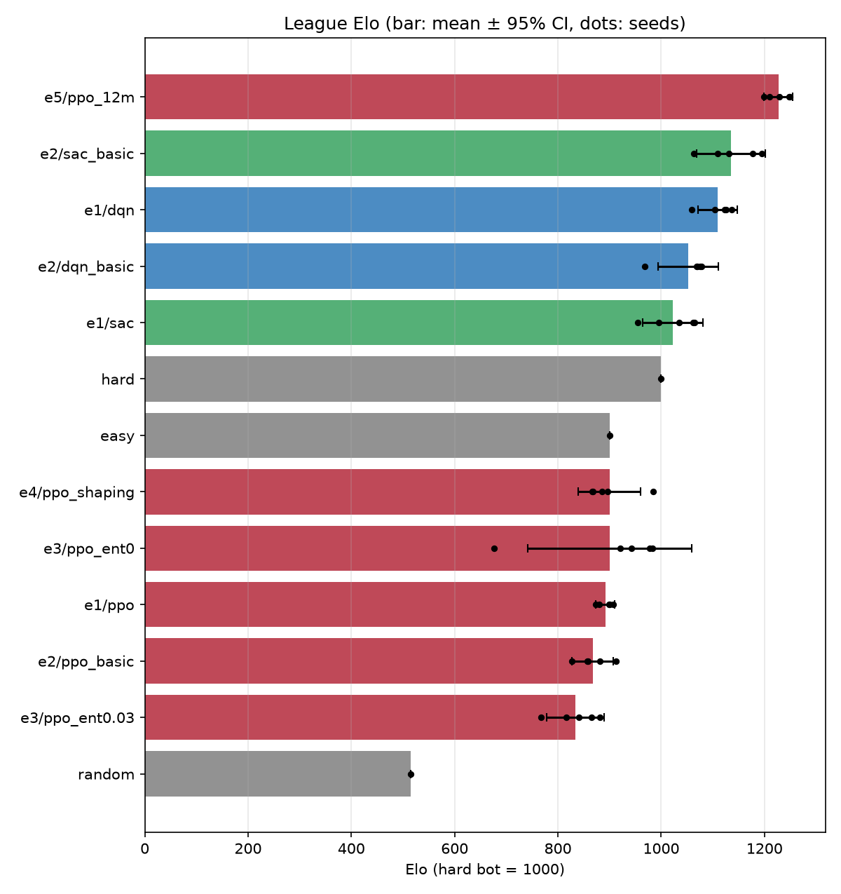

## E1 알고리즘 비교 (같은 300만 스텝)

| 알고리즘 | vs 무작위 | vs 쉬움 | vs 어려움 | 스파이크/점 | 다이빙/점 | 학습 시간(분) |
|---|---|---|---|---|---|---|
| DQN | 0.97 ± 0.01 | 0.77 ± 0.07 | **0.67 ± 0.07** | 2.18 ± 0.68 | 6.02 ± 3.38 | 56 |
| SAC | 0.97 ± 0.02 | 0.73 ± 0.06 | 0.55 ± 0.04 | 7.74 ± 1.05 | 0.71 ± 0.60 | 128 |
| PPO | 0.92 ± 0.02 | 0.41 ± 0.11 | 0.26 ± 0.09 | 1.95 ± 0.93 | 0.00 ± 0.00 | 10 |

seed별 어려움 봇 상대 승률: DQN 0.60 0.68 0.68 0.64 0.76 / SAC 0.52 0.54 0.55 0.55 0.59 / PPO 0.17 0.34 0.30 0.30 0.20

리그전 직접 대결 승률: DQN이 SAC를 0.64, PPO를 0.73으로 이기고, SAC가 PPO를 0.75로 이긴다.

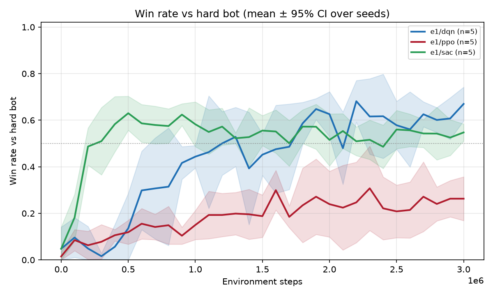

관찰
- **같은 스텝에서는 DQN > SAC > PPO**이고, 봇 상대 승률과 리그전 순위가 일치한다.
- **SAC는 가장 빨리 배운다.** 20만 스텝에 어려움 봇 상대 승률 0.5에 도달하지만 이후 0.55 근처에서 멈춘다. DQN은 느리게 출발해서 150만 스텝 이후 SAC를 앞지른다.
- **seed 간 편차는 SAC가 가장 작다** (0.52~0.59). DQN과 PPO는 seed에 따라 결과가 크게 갈린다.
- **알고리즘마다 플레이 스타일이 다르다.** SAC는 점당 스파이크 7.7회로 공격 위주, DQN은 다이빙 6회로 수비 위주, PPO는 다이빙을 전혀 쓰지 않는다.

## E2 행동 공간 (확장 18개 vs 기본 6개)

기본 행동은 이동·점프만 남기고 스파이크·다이빙을 뺀 것이다.

| 알고리즘 | 확장 (vs 어려움) | 기본 (vs 어려움) | 리그전에서 기본이 확장을 이긴 비율 |
|---|---|---|---|
| SAC | 0.55 ± 0.04 | **0.88 ± 0.10** | 0.69 |
| DQN | 0.67 ± 0.07 | 0.65 ± 0.14 | 0.37 |
| PPO | 0.26 ± 0.09 | 0.42 ± 0.13 | (Elo 875 vs 886, 차이 없음) |

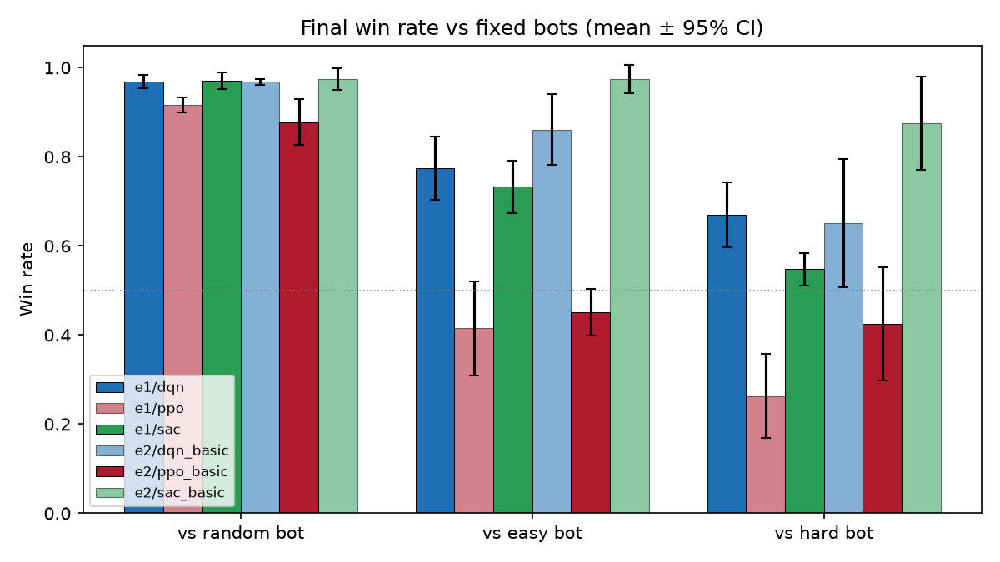

관찰
- **SAC는 행동을 줄이자 크게 좋아졌다.** 봇 상대 승률이 0.55에서 0.88로 오르고, 리그전에서도 확장 SAC를 0.69로 이긴다. 행동이 18개일 때는 스파이크를 남발하는 쪽으로 수렴한 것으로 보인다(점당 7.7회).
- **DQN은 반대다.** 봇 상대 승률은 같지만 리그전에서는 확장 DQN에 0.37로 진다. 봇은 스파이크·다이빙 없이도 이길 수 있지만, 그 기술을 쓰는 학습된 상대에게는 기술이 필요하다는 뜻이다.
- **봇 상대 승률과 리그전 결과가 엇갈리는 사례다.** 기본 SAC는 봇에게 0.88로 가장 강하지만 리그전에서는 DQN과 대등하다(0.47). 봇만으로 평가했다면 과대평가했을 것이다.

## E3 PPO entropy 계수 / E4 보조 보상

| PPO 설정 | vs 어려움 | Elo |
|---|---|---|
| entropy 0 | 0.28 ± 0.16 | 899 ± 157 |
| entropy 0.01 (기본) | 0.26 ± 0.09 | 886 ± 22 |
| entropy 0.03 | 0.19 ± 0.09 | 829 ± 67 |
| 보조 보상 +0.1 | 0.32 ± 0.09 | 897 ± 73 |

관찰
- **entropy 계수와 보조 보상은 의미 있는 차이를 만들지 못했다.** 신뢰구간이 모두 겹친다. entropy 0.03은 다소 나빠지는 경향만 보인다.
- entropy 0은 seed 하나(seed 4)가 크게 무너져서 신뢰구간이 넓다. 탐험이 없으면 결과가 불안정해진다.
- 즉 PPO의 약세는 이 하이퍼파라미터들 때문이 아니다.

## E5 같은 시간 비교 (PPO 1200만 스텝)

| 설정 | 스텝 | 학습 시간(분) | vs 어려움 | Elo |
|---|---|---|---|---|
| PPO | 300만 | 10 | 0.26 ± 0.09 | 886 ± 22 |
| **PPO** | **1200만** | **35** | 0.63 ± 0.10 | **1245 ± 35** |
| DQN | 300만 | 56 | 0.67 ± 0.07 | 1107 ± 38 |
| SAC | 300만 | 128 | 0.55 ± 0.04 | 1025 ± 51 |

관찰
- **PPO에 스텝을 4배 주면 리그전 1위가 된다.** DQN을 0.70, SAC를 0.82로 이긴다. 그래도 학습 시간은 DQN보다 짧다.
- PPO는 데이터를 한 번 쓰고 버리고, DQN·SAC는 리플레이 버퍼로 데이터를 여러 번 재사용한다. 그래서 **스텝 기준으로는 off-policy가 유리하고, 시간 기준으로는 PPO가 유리하다.**
- "어떤 알고리즘이 더 좋은가"의 답은 무엇을 같게 맞추느냐에 따라 뒤집힌다.

## E6 SAC 목표 엔트로피

SAC는 정책의 엔트로피가 목표값(비율 × log 행동 수)을 유지하도록 alpha를 자동으로 조절한다. 기본 비율은 0.3이다.

| SAC 설정 | vs 어려움 | 스파이크/점 | Elo | 리그전에서 기본 SAC를 이긴 비율 |
|---|---|---|---|---|
| 목표 엔트로피 0.1 | 0.59 ± 0.13 | 8.79 ± 3.59 | 1051 ± 41 | 0.53 |
| 목표 엔트로피 0.3 (기본) | 0.55 ± 0.04 | 7.74 ± 1.05 | 1025 ± 51 | - |
| 목표 엔트로피 0.5 | 0.57 ± 0.08 | 7.31 ± 0.99 | 1061 ± 48 | 0.51 |

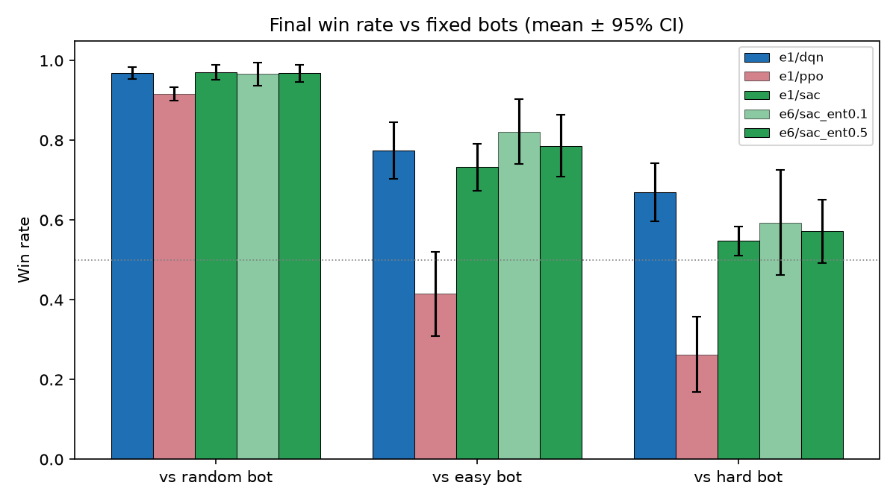

관찰
- **목표 엔트로피는 결과를 거의 바꾸지 못했다.** 세 설정 모두 0.55~0.59에 머물고, 리그전 직접 대결도 0.5 근처다.
- 탐험을 줄이든(0.1) 늘리든(0.5) 스파이크 위주 플레이(점당 7~9회)는 그대로였다.
- 즉 확장 행동 SAC가 0.55에서 멈추는 원인은 탐험 정도가 아니다. E2에서 기본 행동으로 바꾸자 0.88이 된 것과 함께 보면, **행동 공간 자체**가 원인이라고 볼 수 있다.

## E7 DQN 탐험 기간

epsilon을 1.0에서 0.05로 줄이는 구간을 전체 학습의 10% / 30%(기본) / 50%로 바꿨다.

| DQN 설정 | vs 어려움 | seed별 값 | Elo | 리그전에서 기본 DQN을 이긴 비율 |
|---|---|---|---|---|
| 0.1 (짧게) | 0.55 ± 0.17 | 0.59 0.61 0.32 0.69 0.57 | 1072 ± 99 | 0.47 |
| 0.3 (기본) | 0.67 ± 0.07 | 0.60 0.68 0.68 0.64 0.76 | 1107 ± 38 | - |
| 0.5 (길게) | 0.61 ± 0.06 | 0.58 0.65 0.62 0.54 0.64 | 1067 ± 57 | 0.45 |

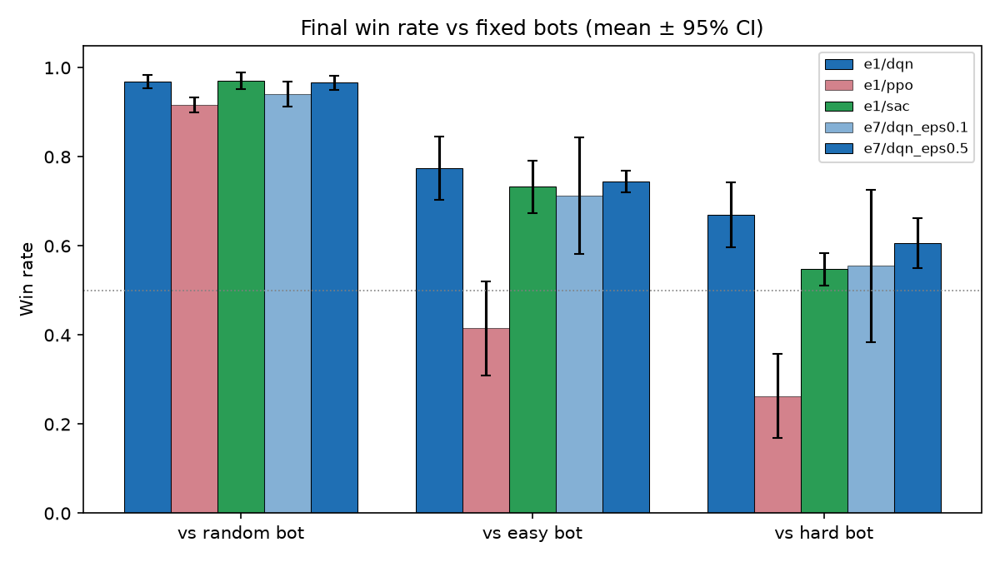

관찰
- **기본값 0.3이 가장 좋았지만, 차이는 신뢰구간 안이다.** 리그전 직접 대결도 0.45~0.47로 거의 대등하다.
- **탐험을 짧게 하면 불안정해진다.** 0.1에서는 seed 하나(seed 2)가 0.32로 무너져서 신뢰구간이 가장 넓다. E3의 PPO entropy 0과 같은 현상이다.
- 탐험을 길게 하면 seed 간 편차는 작아지지만 평균은 조금 낮다.

## E8 학습 상대 구성 (PPO)

학습 상대 중 과거 자신(self-play)의 비율을 바꿨다. 나머지는 쉬움 봇과 무작위 봇이 반씩 차지한다.

| PPO 설정 | 과거 자신 : 쉬움 : 무작위 | vs 어려움 | Elo |
|---|---|---|---|
| self-play 0.3 | 0.3 : 0.35 : 0.35 | 0.32 ± 0.16 | 860 ± 71 |
| self-play 0.6 (기본) | 0.6 : 0.2 : 0.2 | 0.26 ± 0.09 | 886 ± 22 |
| self-play 0.9 | 0.9 : 0.05 : 0.05 | 0.35 ± 0.14 | **946 ± 76** |

리그전 직접 대결: self-play 0.9가 기본을 0.63, self-play 0.3을 0.64로 이긴다.

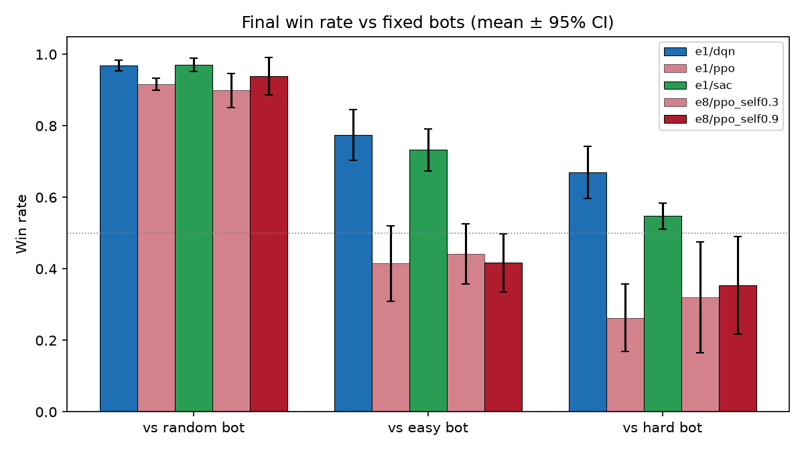

관찰
- **봇 상대 승률로는 차이가 없지만, 리그전에서는 self-play 비율이 높을수록 강하다.** 어려움 봇 상대 승률은 세 설정 모두 신뢰구간이 겹친다. 반면 리그전에서는 0.9가 다른 두 설정을 0.63~0.64로 이긴다.
- self-play를 많이 하면 학습된 상대를 다루는 법을 더 배운다. 봇은 그 차이를 잡아내지 못하고, 리그전은 잡아낸다. E2의 SAC 사례와 같은 이유로 두 지표를 함께 봐야 한다.
- 다만 Elo 신뢰구간(946 ± 76, 860 ± 71)은 살짝 겹치므로 seed를 늘려 확인할 필요가 있다.

## 토의

1. **비교 기준의 선택이 결론을 바꾼다.** 같은 스텝이면 DQN, 같은 시간이면 PPO가 가장 강하다. 시뮬레이터가 빠른 환경에서는 PPO, 데이터 수집이 비싼 환경(실제 로봇 등)에서는 DQN·SAC가 유리하다고 해석할 수 있다.
2. **행동이 많다고 좋은 게 아니다.** SAC는 기술이 없는 기본 행동에서 오히려 훨씬 강했다. 반면 DQN은 기술이 있어야 학습된 상대를 이겼다. 같은 환경 변화가 알고리즘마다 반대로 작용했다.
3. **평가 상대가 하나면 위험하다.** 기본 SAC는 봇 기준으로는 압도적이지만 리그전 기준으로는 DQN과 비슷했다. 고정 봇과 리그전을 함께 써야 결론을 믿을 수 있다.
4. **알고리즘마다 고유한 플레이 스타일이 생겼다.** 최대 엔트로피를 추구하는 SAC는 공격적인 스파이크, 가치 기반인 DQN은 다이빙 수비 위주였다. SAC의 스파이크 위주 스타일은 목표 엔트로피를 바꿔도 유지됐다(E6).
5. **하이퍼파라미터보다 구조적 선택의 영향이 컸다.** 세 알고리즘의 주요 탐험 하이퍼파라미터(PPO entropy, SAC 목표 엔트로피, DQN epsilon 구간)는 모두 신뢰구간 안의 차이만 만들었다. 반면 학습량(E5)과 행동 공간(E2)은 결과를 크게 바꿨고, 학습 상대(E8)도 리그전 순위를 바꿨다.
6. **탐험이 부족하면 seed 하나가 무너진다.** PPO entropy 0(E3)과 DQN epsilon 구간 0.1(E7)에서 각각 seed 하나가 크게 실패했다. 평균보다 seed 간 편차에서 탐험의 역할이 드러났다.

## 한계와 개선 방향

- **하이퍼파라미터는 알고리즘마다 탐험 관련 값 하나씩만 조정했다.** 학습률, 네트워크 크기 등은 세 알고리즘 모두 기본값이다.
- **E5는 PPO에만 스텝을 늘렸다.** DQN·SAC도 같은 시간(35분, 2시간 등)을 맞춘 비교가 더 정확하다.
- **seed 5개는 작은 표본이다.** 신뢰구간이 넓은 설정(E3 entropy 0 등)은 seed를 늘려야 결론을 낼 수 있다.
- **봇은 직접 만든 규칙이라 약점이 있다.** 리그전으로 보완했지만, 사람 플레이어와의 대결 같은 외부 기준이 있으면 더 좋다.
- **학습 상대 구성(E8)은 PPO에서만 바꿔 봤다.** DQN·SAC에서도 같은 경향인지는 확인하지 않았다.

---

# 레이저 미션 결과

환경 설명은 [laser.md](laser.md)에 있다. 모두 400만 스텝, seed 3개다. 학습이 끝난 뒤 학습에 쓰지 않은 seed로 레벨마다 200판(가장 좋은 행동)을 돌린 성공률이다. 평균 ± 95% 신뢰구간이며, 표본 단위는 학습 seed다.

| 설정 | 레벨 1 | 레벨 2 | 레벨 3 | 레벨 4 | 평균 (1~4) | seed별 평균 | 학습 시간(분) |
|---|---|---|---|---|---|---|---|
| SAC (커리큘럼) | 0.57 ± 1.27 | 0.66 ± 1.41 | 0.64 ± 1.37 | 0.62 ± 1.34 | **0.62 ± 1.34** | 0.98 / 0.00 / 0.89 | 214 |
| PPO 레벨 무작위 | 0.88 ± 0.28 | 0.75 ± 0.28 | 0.53 ± 0.35 | 0.46 ± 0.35 | **0.66 ± 0.31** | 0.80 / 0.62 / 0.55 | 17 |
| PPO 다가가기 보상 없음 | 0.75 ± 0.30 | 0.80 ± 0.29 | 0.65 ± 0.27 | 0.45 ± 0.27 | **0.66 ± 0.23** | 0.57 / 0.75 / 0.67 | 13 |
| PPO 시간 벌점 없음 | 0.80 ± 0.16 | 0.62 ± 0.46 | 0.54 ± 0.39 | 0.40 ± 0.37 | **0.59 ± 0.34** | 0.49 / 0.53 / 0.75 | 14 |
| PPO 커리큘럼 + 복습 | 0.79 ± 0.09 | 0.75 ± 0.06 | 0.46 ± 0.12 | 0.28 ± 0.02 | **0.57 ± 0.02** | 0.57 / 0.58 / 0.57 | 12 |
| PPO 원래 관측 | 0.64 ± 0.39 | 0.57 ± 0.22 | 0.62 ± 0.39 | 0.44 ± 0.57 | **0.57 ± 0.20** | 0.54 / 0.50 / 0.66 | 14 |
| PPO 커리큘럼 (기본) | 0.71 ± 0.19 | 0.62 ± 0.11 | 0.49 ± 0.22 | 0.31 ± 0.07 | **0.53 ± 0.06** | 0.51 / 0.54 / 0.55 | 21 |
| PPO 처음부터 레벨 4 | 0.28 ± 0.15 | 0.50 ± 0.40 | 0.48 ± 0.11 | 0.42 ± 0.12 | **0.42 ± 0.17** | 0.49 / 0.36 / 0.41 | 14 |
| DQN (커리큘럼) | 0.14 ± 0.40 | 0.42 ± 0.96 | 0.78 ± 0.30 | 0.27 ± 0.17 | **0.40 ± 0.37** | 0.42 / 0.24 / 0.54 | 105 |

학습 시간은 8개를 동시에 돌린 기준이다.

## X1 알고리즘 비교

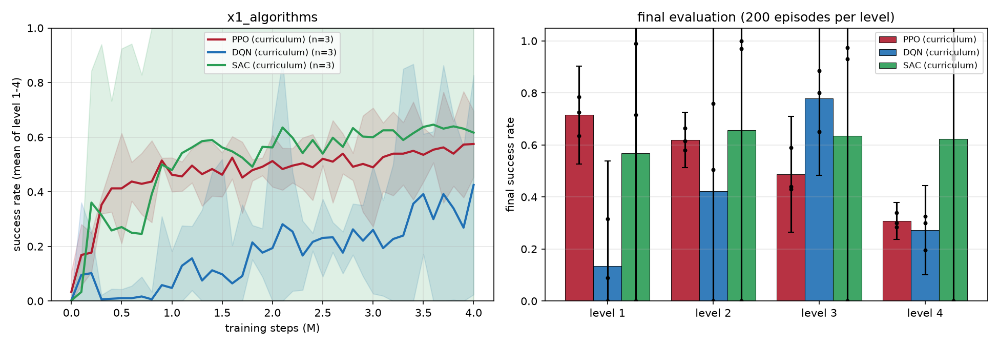

- **SAC는 잘 되면 거의 완벽하지만, 한 번 무너지면 회복하지 못했다.** seed 0·2는 레벨 1~4 평균 0.98·0.89로 PPO(최고 0.55)보다 훨씬 높았다. seed 1은 레벨 2에서 Q값이 발산했다. 50만 스텝 무렵 Q 손실이 0.03에서 44,000까지 치솟았고, 이후 끝까지 한 판도 통과하지 못했다. 그래서 평균은 PPO와 비슷하지만 신뢰구간이 매우 넓다.
- **PPO는 가장 안정적이었다.** seed 3개가 0.51~0.55로 거의 같았다. 대신 학습 레벨 3에서 기준(성공률 0.8)을 넘지 못해 레벨 4로 올라가지 못했다.
- **DQN은 가장 불안정했다.** 레벨 3은 0.78인데 레벨 1은 0.14였다. 쉬운 레벨을 못 하는 이유는 아래 커리큘럼 문제와 같다.

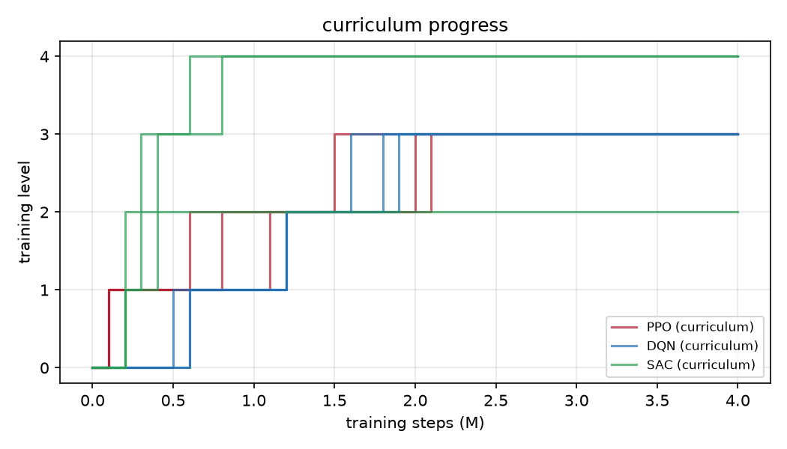

SAC는 80만 스텝 안에 레벨 4까지 올라갔다(seed 0·2). PPO와 DQN은 레벨 3에서 멈췄다.

## X2 학습 방식

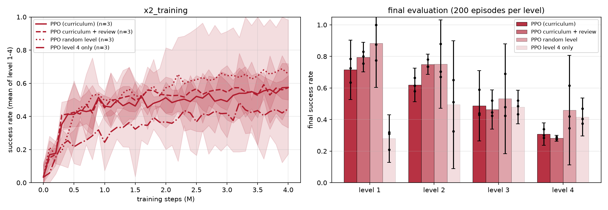

- **레벨 무작위가 커리큘럼보다 좋았다 (0.66 vs 0.53).** 커리큘럼 PPO는 레벨 3만 오래 연습하면서 레벨 1 성공률이 0.71로 떨어졌다. 쉬운 레벨을 잊은 것이다.
- **복습을 넣은 커리큘럼은 레벨 1·2를 회복했다 (0.71 → 0.79, 0.62 → 0.75).** 학습 판의 절반을 지금보다 낮은 레벨에서 하도록 바꾼 변형이다. 하지만 레벨 3·4 연습이 절반으로 줄어 평균은 0.57로 조금만 올랐다. seed 사이 편차는 가장 작았다(± 0.02).
- **처음부터 레벨 4만 하면 가장 나빴다 (0.42).** 성공 경험이 드물어서 학습 신호가 약했다.

## X3 관측 설계

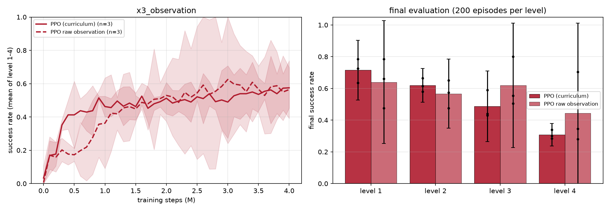

레이저 선분 양 끝 좌표를 그대로 준 원래 관측(0.57)과 설계한 특징(0.53)의 차이는 신뢰구간 안이다. 설계 과정에서 관측을 바꾼 뒤 레벨 1 성공률이 25%에서 90%로 올랐지만, 400만 스텝과 seed 3개로 다시 비교하자 차이가 사라졌다. 당시 개선은 짧은 학습에서 초반 학습 속도가 빨라진 효과였던 것으로 보인다. 학습량이 충분하면 신경망이 원시 좌표에서도 필요한 특징을 스스로 찾는다.

## X4 보상 설계

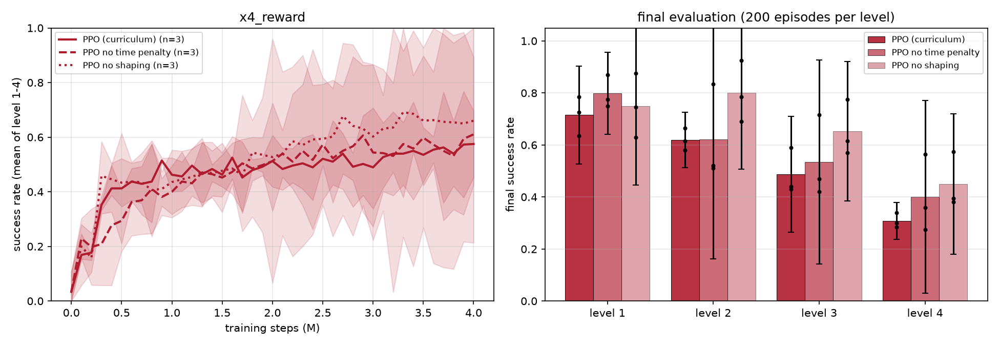

시간 벌점을 빼도(0.59), 다가가기 보조 보상을 빼도(0.66) 기본(0.53)보다 나빠지지 않았다. 설계 단계에서는 시간 벌점이 없으면 레이저 앞에서 버텼다. 그런데 지금 환경에서는 시간 초과가 -1이고 제한 시간이 20초로 짧아서, 이것만으로도 버티기를 충분히 막는 것으로 보인다. 다가가기 보상도 마찬가지로, 출발 직후의 이동은 쉬워서 보조 보상이 없어도 성공 보상만으로 학습됐다.

## 레이저 미션 토의

1. **설계 과정의 개선은 다시 측정해야 한다.** 관측과 보상을 고칠 때마다 성공률이 올랐지만, seed 3개로 다시 비교하면 대부분 신뢰구간 안의 차이였다. 고칠 때는 여러 수정이 동시에 들어갔고, 짧은 학습과 seed 1개로 판단했기 때문이다.
2. **SAC는 표본 효율이 가장 높지만 위험하다.** 같은 스텝에서 가장 높은 성공률에 도달했지만 seed 3개 중 1개가 발산했다. 배구에서 탐험이 부족할 때 seed 하나가 무너진 것과 같은 모양이다.
3. **커리큘럼에는 망각 문제가 있다.** 다음 레벨로 넘어가면 앞 레벨을 잊는다. 레벨을 무작위로 섞는 쪽이 오히려 나았다.
4. **seed가 무너진 원인을 찾으면 고칠 수 있다.** SAC의 실패는 운이 아니라 Q값 발산이라는 구체적인 원인이 있었다. 로그(Q 손실, 엔트로피, alpha)로 원인을 짚고, 목표값 범위를 제한해서 평균을 0.62에서 0.93으로 올렸다.
5. **PPO의 정체는 학습량 문제였다.** 400만 스텝에서 0.66이던 PPO가 2000만 스텝에서 0.87이 됐다. 설정 비교의 결론은 학습량을 고정한 결과라는 점을 함께 봐야 한다.

## X5 학습량 (PPO 2000만 스텝)

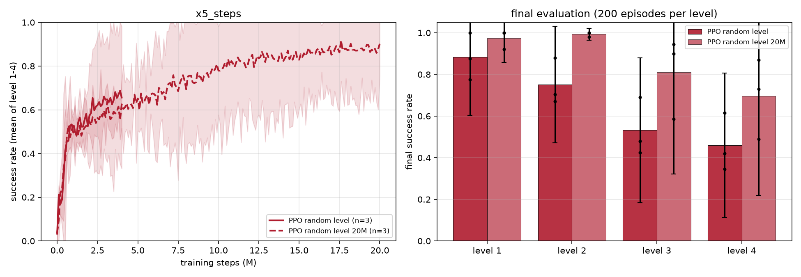

레벨 무작위 PPO의 평균 성공률은 400만 스텝에서 0.66, 2000만 스텝(57분)에서 0.87 ± 0.27이었다. 2000만 스텝의 seed별 값은 0.74 / 0.91 / 0.95이며 레벨 1·2 성공률은 거의 100%였다.

두 학습량 설정은 서로 다른 Unity 빌드를 사용했다. 동일한 시드와 행동을 재생한 검증에서 일부 레벨의 관측과 보상이 달랐으므로, 성공률 차이를 스텝 예산만의 효과로 해석하기는 어렵다.

## X6·X7 SAC 안정화

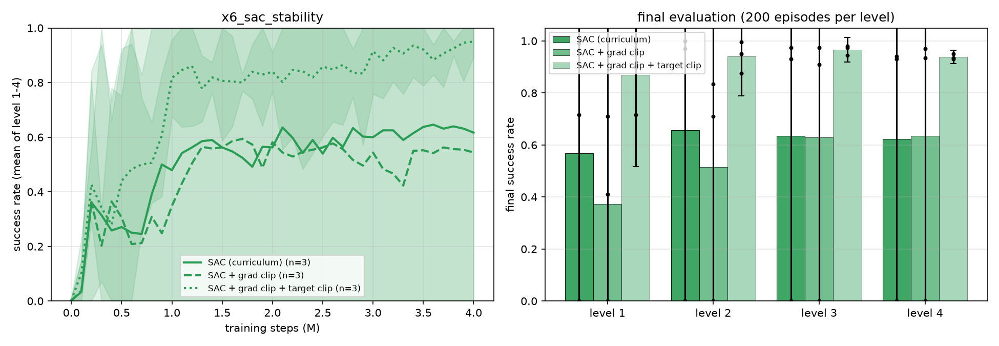

X1에서 SAC seed 1이 Q값 발산으로 무너진 원인을 두 단계로 고쳤다.

| 설정 | seed별 평균 성공률 | 평균 | 결과 |
|---|---|---|---|
| SAC 기본 (X1) | 0.98 / 0.00 / 0.89 | 0.62 ± 1.34 | seed 1이 레벨 2에서 발산 (Q 손실 최대 44,000) |
| + 기울기 노름 상한 10 (X6) | 0.74 / 0.00 / 0.87 | 0.54 ± 1.17 | 발산 크기는 줄었지만(최대 356) 커리큘럼 레벨이 오를 때마다 다시 발산 |
| + 목표값 범위 ±3 (X7) | 0.87 / 0.97 / 0.95 | **0.93 ± 0.14** | 세 seed 모두 안정, 전체에서 가장 좋음 |

X6과 X7은 같은 Unity 빌드와 시드를 사용했고, 설정 차이는 목표값 범위 제한 한 항목이었다. 기본 SAC(X1)와 X6은 Unity 빌드도 달라서, 두 결과의 차이에 기울기 제한 외에 빌드 차이가 포함됐을 가능성이 있다.

- **관측된 현상:** 커리큘럼 전환 근처에서 Q 손실이 치솟고, 정책 엔트로피가 0.06까지 떨어지며 alpha가 급등했다. 새로운 상태 분포와 부트스트래핑으로 추정 오차가 커졌을 가능성이 있다. 로그만으로 각각의 인과 효과를 분리할 수는 없다.
- **기울기 상한은 한 번에 움직이는 양만 줄인다.** 잘못된 목표값을 향해 천천히 가는 것은 막지 못했다.
- **목표값 범위를 ±3으로 제한한 설정**에서는 세 seed 모두 성공했다. ±3은 에피소드 보상 크기를 참고해 고른 값이다. SAC의 soft Bellman 목표값에는 엔트로피 항도 들어가므로 이 값은 실험적으로 적용한 안정화 설정이다.
- 두 옵션은 기본값이 꺼져 있어 배구 실험 결과는 바뀌지 않는다.

## 레이저 미션 결론

| 순위 | 설정 | 성공률 (레벨 1~4) | 학습 시간 |
|---|---|---|---|
| 1 | SAC + 기울기 상한 + 목표값 범위 (400만 스텝) | **0.93 ± 0.14** | 180분 |
| 2 | PPO 레벨 무작위 (2000만 스텝) | 0.87 ± 0.27 | 57분 |
| 3 | PPO 레벨 무작위 (400만 스텝) | 0.66 ± 0.31 | 17분 |

레벨 4(무작위 레이저 5개, 1.3배 속도)에서는 SAC 400만 스텝 설정이 0.94, PPO 2000만 스텝 설정이 0.70이었다. 두 설정은 학습 방식과 스텝 예산이 다르다. 측정된 학습 시간은 주어진 하드웨어와 병렬 실행 조건에서의 기록이다.

## X8 레벨 5 재검증 및 레벨 6 전이 평가

초기 X8의 Unity 복사본은 레벨 5를 요청하면 실제 레벨 4를 실행했다. Unity 실행 파일의 수정 시각만으로 빌드를 식별하면서 이전 복사본을 재사용했다. 초기 X8 수치는 레벨 5 분석에서 제외했다. 새 실행은 빌드 내용의 지문을 기록하고, 평가 시 Unity가 돌려준 실제 레벨을 검사한다.

레벨 4까지 학습한 대표 체크포인트로 새 빌드에서 전이를 점검했다. 환경 seed 777, 레벨별 200판, 알고리즘별 학습 seed 하나씩을 사용했다.

| 체크포인트 | 레벨 4 성공률 | 레벨 5 성공률 | 레벨 6 성공률 |
|---|---:|---:|---:|
| SAC (학습 seed 1) | 96% | 0% | 0% |
| PPO (학습 seed 2) | 84% | 0% | 0% |

레벨 5와 6에서 두 정책의 충돌률은 99.5~100%였다. X8에서는 레벨 5를 포함해 다시 학습한다.

레벨 6의 통과 가능성은 Unity의 실제 이동·충돌 함수로 별도 확인했다. 전체 시뮬레이션 상태에 접근하는 빔 탐색으로 환경 시드 777~788의 배치 12개를 조사했다. 처음 탐색으로 10개에서 경로를 찾았고, 나머지 2개는 후보 수를 늘려 경로를 찾았다. 12개 경로를 출발 상태에서 순서대로 재생하자 모두 20초 안에 도착했다(4.58~11.42초). 이 검사는 표본 배치에서 통과 경로가 있음을 확인한 결과이며 학습 정책의 평가와는 별개다.

### 레벨 5를 포함한 PPO 재학습

레벨 1~5 무작위 설정에서 2,000만 스텝씩 학습했다. 각 시드의 최종 정책을 검증된 빌드에서 레벨당 200판 평가했다.

| 학습 시드 | 레벨 4 성공률 | 레벨 5 성공 횟수 | 레벨 5 성공률 |
|---|---:|---:|---:|
| 0 | 73.5% | 0 / 200 | 0.0% |
| 1 | 83.5% | 1 / 200 | 0.5% |
| 2 | 54.0% | 2 / 200 | 1.0% |

레벨 5 평균은 0.50%, 학습 시드를 표본으로 한 95% t 신뢰구간 반폭은 1.24%p다. 당시 기록은 실패 597판을 충돌로 분류했다. 이전 평가기의 시간 초과 분류 제한은 [체크리스트](laser.md#formulation)에 기록했다. 이 설정은 어려운 레벨을 넣어 학습한 뒤에도 레벨 5에서 안정적으로 통과하지 못했다.

### 레벨 5를 포함한 SAC 재학습

커리큘럼 0→5와 X7의 안정화 설정을 사용해 시드별로 400만 스텝을 학습했다. 최종 레벨 5 성공률은 **91.5% (549/600판)**였고, 학습 시드 기준 95% t 신뢰구간 반폭은 7.76%p다.

| 학습 시드 | 레벨 4 성공률 | 레벨 5 성공률 | 레벨 6 전이 성공률 |
|---|---:|---:|---:|
| 0 | 34.5% | 92.5% | 4.0% |
| 1 | 40.5% | 94.0% | 4.5% |
| 2 | 33.5% | 88.0% | 2.0% |
| 평균 | 36.2% | 91.5% | 3.5% |

레벨 6은 추가 학습 없이 별도 평가 환경 시드 1777에서 정책당 200판 평가했다. X8의 SAC와 PPO는 학습 예산과 레벨 배정 방식이 달라 각 설정의 결과로 해석한다. SAC가 레벨 5에서 높은 통과율을 보이는 동안 레벨 4 성공률은 36.2%였다. 레벨 5에 도달한 뒤 레벨 4 복습을 섞는 대조 실험으로, 이전 레벨의 성능을 유지하면서 레벨 5를 학습할 수 있는지 확인할 수 있다.

### X9 레벨 4 복습 실험

X8 SAC와 같은 시드 0·1·2, 시드당 400만 스텝, 같은 보상·알고리즘 설정을 사용한다. 레벨 5에 도달한 뒤 새 에피소드를 레벨 4에 배정할 확률을 25%로 설정한다. 평가에서는 레벨을 각각 고정해 시드당 200판을 플레이한다. 레벨 4와 5의 성공률 변화는 같은 학습 시드끼리 짝지어 요약한다.

빌드 검증에서 복습을 끈 상태의 관측·보상·종료 판정이 기존 빌드와 1,600개 전이에서 일치했다. 복습을 켜고 레벨 5를 요청한 1,024개 에피소드에서는 레벨 4가 233회, 레벨 5가 791회 배정됐다. 이 표본은 배정 로직을 검증하기 위한 것이다.

### X10 레벨 1~6 일반화

기존 X7 SAC, X8 SAC, X8 PPO의 최종 모델을 각각 학습 시드 3개씩 평가했다. 환경 시드 5777과 동일한 Unity 빌드를 사용해 모델마다 레벨별 200판을 플레이했다. 전체 레벨을 목표로 할 때는 평균과 함께 레벨별 최저 성공률을 본다.

| 기존 모델 | 레벨 1 | 레벨 2 | 레벨 3 | 레벨 4 | 레벨 5 | 레벨 6 | 평균 | 최저 |
|---|---:|---:|---:|---:|---:|---:|---:|---:|
| X7 SAC seed 1 | 99.5% | 96.5% | 97.0% | 95.0% | 0.0% | 0.0% | 64.7% | 0.0% |
| X8 SAC seed 0 | 80.0% | 88.5% | 44.5% | 29.0% | 94.0% | 3.0% | 56.5% | 3.0% |
| X8 SAC seed 1 | 27.5% | 39.5% | 56.0% | 37.0% | 93.5% | 2.0% | 42.6% | 2.0% |

기존 모델 9개의 최저 성공률 가운데 가장 높은 값은 3.5%였다. X10에서는 레벨 0부터 6까지 하나의 SAC 정책을 학습한다. 레벨 2부터 새 에피소드의 50%는 이전 레벨 1~현재 레벨−1에 균등하게 배정한다. 성공률을 통한 승급에는 실제 현재 레벨에서 플레이한 판만 포함한다. 단계별 누적 스텝 상한을 두어 늦어도 450만 스텝에 레벨 6을 배정하기 시작한다. 각 학습 시드의 예산은 800만 스텝이며 레벨별 성공률, 레벨 1~6 평균, 레벨 1~6 최저값을 기록한다.

## X11·X12 레벨 1~10 캠페인 (1,200만 스텝, 처음부터 학습)

게임을 1~10단계 캠페인으로 확장한 뒤, 세 알고리즘을 같은 빌드·같은 설정(레벨 2부터 50% 이전 단계 복습)으로 시드 0·1·2에서 처음부터 학습했다. 모델마다 레벨별 200판과 순차 캠페인 200회(단계당 최대 3번 시도)를 평가했다. 평가는 방마다 게임 시간 0에서 시작한 판만 센다.

| 알고리즘 | L1 | L2 | L3 | L4 | L5 | L6 | L7 | L8 | L9 | L10 | 평균 (시드 기준 95% CI) | 10단계 완주 |
|---|---:|---:|---:|---:|---:|---:|---:|---:|---:|---:|---:|---:|
| SAC | 100% | 91% | 94% | 94% | 61% | 0% | 77% | 40% | 0% | 18% | **57.5% ± 24.2** | 0/600 |
| PPO | 100% | 100% | 100% | 100% | 63% | 11% | 0% | 33% | 0% | 9% | **51.6% ± 15.4** | 0/600 |
| Double DQN | 8% | 25% | 8% | 8% | 0% | 0% | 0% | 0% | 0% | 0% | **4.9% ± 21.2** | 0/600 |

SAC 시드 1·2는 학습 프로세스가 1,184만·1,166만 스텝에서 종료되어 마지막 저장 모델로 평가했다. 시드 0은 1,200만 스텝을 마쳤다.

- **하나의 정책으로 10단계를 완주한 경우는 세 알고리즘 모두 없었다.** 레벨 6과 9는 아홉 모델 중 PPO 시드 1 하나(레벨 6, 34%)를 빼면 모두 0%였다.
- SAC와 PPO는 레벨 1~4를 대부분 통과했고, 평균은 비슷하다. DQN은 시드 3개 중 2개가 모든 레벨에서 0%였다.
- 레벨 수가 많아지자 한 정책이 모든 단계를 동시에 유지하지 못했다. 레벨별 성공률이 시드마다 다른 단계에서 무너졌다(예: SAC 시드 0은 레벨 8이 21%, 시드 1은 100%).

### 단계별 정책 선택 (PPO)

단일 정책의 한계를 확인한 뒤, 막힌 단계(6·7·9)는 그 단계만 추가 학습한 PPO actor를 만들고 단계마다 검증 성공률이 가장 높은 정책을 골라 썼다. 평가 시드는 검증과 다르다. 자세한 표는 `runs/results/laser/ppo_specialists.md`에 있다.

| 정책 | 1~10단계 평균 성공률 | 10단계 완주 (단계당 3번) | 10단계 완주 (단계당 10번) |
|---|---:|---:|---:|
| 단일 PPO | 51.6% | 0 / 600 | - |
| 단계별 PPO | 82.4% | **389 / 600 (64.8%)** | **586 / 600 (97.7%)** |

단계별 정책은 하나의 정책으로 모든 단계를 푸는 것이 아니므로 위 알고리즘 비교와 별도 결과로 본다. 이 결과는 실패 원인이 "단계가 풀 수 없을 만큼 어려움"이 아니라 "한 정책이 여러 단계를 동시에 유지하지 못함(망각과 간섭)"에 있음을 보여 준다.

## 모방 학습: 단계별 PPO를 정책 하나로 합치기 (11장)

X11·X12에서 정책 하나로 강화학습을 하면 10단계를 한 번도 완주하지 못했다. 반면 단계마다 다른 PPO 정책(선생님)을 쓰면 완주했다. 그래서 선생님들의 행동을 학생 정책 하나가 따라 하도록 모방 학습을 적용했다. 학생 신경망은 PPO actor와 같은 크기다(66 → 256 → 256 → 27). 손실은 선생님 행동을 정답으로 한 cross-entropy다.

| 방식 | 데이터 |
|---|---|
| Behavior Cloning | 선생님이 플레이한 상태만 모은다 |
| DAgger | 1회차는 선생님이 플레이한다. 2회차부터는 학생이 플레이한 상태에 선생님이 정답을 붙이고, 데이터를 합쳐 다시 학습한다 |

두 방식 모두 8회차, 회차마다 단계별 400번 결정 × 방 16개(누적 51만 2천 개 상태), 회차마다 4 epoch씩 학습했다. 학생 seed는 0·1·2다. 평가는 레벨별 200판과 순차 캠페인 200회(단계당 최대 3번)로 했고, 평가 환경 seed는 데이터 수집과 다르다.

| 정책 | L1 | L2 | L3 | L4 | L5 | L6 | L7 | L8 | L9 | L10 | 평균 (95% CI) | 10단계 완주 |
|---|---:|---:|---:|---:|---:|---:|---:|---:|---:|---:|---:|---:|
| Behavior Cloning (학생 1개) | 100% | 100% | 100% | 100% | 77% | 49% | 73% | 100% | 100% | 27% | 82.7% ± 0.7 | **361/600 (60.2%)** |
| DAgger (학생 1개) | 100% | 100% | 100% | 100% | 77% | 49% | 73% | 100% | 100% | 27% | 82.7% ± 0.7 | **361/600 (60.2%)** |

- **정책 하나로 처음으로 10단계를 완주했다.** 강화학습만 쓴 단일 정책(SAC·PPO·DQN)은 600회 중 0회였다. 학생 정책 하나는 600회 중 361회(60.2%)를 완주했다.
- **BC와 DAgger의 결과가 seed마다 완전히 같았다.** 학생이 선생님을 거의 오차 없이 따라 했기 때문이다. 학생이 직접 플레이한 상태에서도 선생님과 행동이 99.99%(BC), 99.77%(DAgger) 일치했다. 같은 평가 seed에서 선생님 자신의 결과(레벨 5 76%, 레벨 6 49.5%, 레벨 10 30.5%, 완주 122/200)도 학생과 같았다.
- **분포 이동이 거의 생기지 않았다.** 강의의 오차 누적 상한 εT²는 ε(선생님과 다른 행동을 할 확률)가 클 때 문제가 된다. 이 환경에서는 관측이 상태를 거의 다 담고(Markov), 선생님이 결정적(greedy)이며, 학생 신경망이 선생님과 같은 크기다. 그래서 ε가 거의 0이었고, DAgger가 고칠 실수가 남지 않았다. DAgger의 이점은 ε가 큰 경우(관측이 부족하거나 학생이 작을 때)에 나타날 것이다.
- **학생의 상한은 선생님이다.** 레벨 5·6·7·10의 실패는 선생님의 실패를 그대로 물려받은 것이다. 완주율을 더 올리려면 약한 단계의 선생님을 개선해야 한다.

### 약한 단계 선생님 개선과 재증류

학생의 상한이 선생님이므로, 약한 단계(5·6·7·10)의 PPO 선생님을 다시 학습했다. 각 단계에서 기존 선생님(10단계는 X12 PPO)을 초기값으로 600만 스텝, seed 2개씩 PPO로 학습했다. 6·10단계는 레이저 벽 통로를 처음에 넓혀 주고 200만 스텝에 걸쳐 원래 폭으로 줄이는 커리큘럼을 썼다. 선생님은 최종 평가와 다른 검증용 환경 seed(77000)에서 단계당 200판으로 골랐다.

| 단계 | 기존 선생님 | 새 PPO (seed 0 / 1) | 선택 |
|---|---:|---:|---:|
| 5 | 71.0% | 100.0% / 100.0% | 100.0% |
| 6 | 49.5% | 100.0% / 100.0% | 100.0% |
| 7 | 79.0% | 100.0% / 100.0% | 100.0% |
| 10 | 22.5% | 27.5% / 74.0% | 74.0% |

| 정책 (학생 1개, seed 3개) | L1 | L2 | L3 | L4 | L5 | L6 | L7 | L8 | L9 | L10 | 평균 (95% CI) | 10단계 완주 |
|---|---:|---:|---:|---:|---:|---:|---:|---:|---:|---:|---:|---:|
| BC, 선생님 v1 | 100% | 100% | 100% | 100% | 77% | 49% | 73% | 100% | 100% | 27% | 82.7% ± 0.7 | **361/600** |
| BC, 선생님 v2 | 100% | 100% | 100% | 100% | 100% | 100% | 100% | 100% | 100% | 71% | 97.1% ± 0.7 | **600/600** |
| DAgger, 선생님 v2 | 100% | 100% | 100% | 100% | 100% | 100% | 100% | 100% | 100% | 71% | 97.1% ± 0.7 | **600/600** |

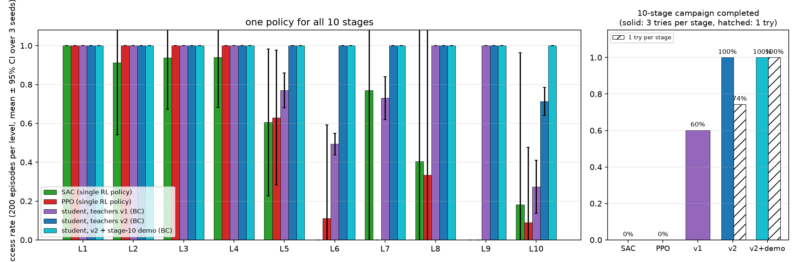

- **정책 하나로 10단계를 600회 모두 완주했다** (단계당 최대 3번 시도). 단계별 성공률은 1~9단계 100%, 10단계 71%다. 10단계를 한 번에 통과할 확률이 0.71이어도, 3번 안에 통과할 확률은 1 − 0.29³ ≈ 0.98이다.
- **한 단계만 학습한 PPO는 다른 단계를 잊었다.** 6단계 전용 선생님의 최종 평가는 6단계 100%였지만 1단계 74%, 5단계 0%였다. 다른 선생님도 모두 같았다. 정책 하나로 강화학습을 할 때 생긴 문제(망각과 간섭)가 그대로 다시 나타났다. 모방 학습은 단계마다 잘하는 선생님의 행동을 한 신경망에 동시에 모아서 이 문제를 피했다.
- **BC와 DAgger는 이번에도 같은 결과였다.** 학생이 직접 플레이한 상태에서 선생님과의 행동 일치율은 BC 99.87%, DAgger 99.5%(가장 낮은 7단계 96.8%)였다. ε가 작아 분포 이동이 결과를 바꾸지 못했다.

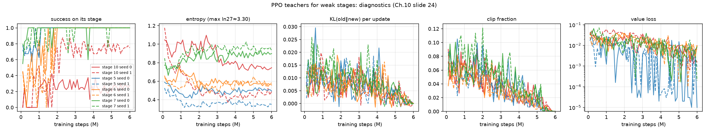

선생님 PPO의 학습 진단 지표(10장 슬라이드 24 기준)는 정상 범위였다. 엔트로피는 천천히 줄었지만 0에 가깝지 않았다(0.35~1.0, 최대 ln 27 ≈ 3.30). 업데이트당 KL은 0.03 이하, clip fraction은 0.12 이하였다. 둘 다 학습률이 줄어드는 학습 후반에 0에 가까워졌다. value loss는 줄어드는 추세였다.

### 10단계 마지막 배치: PPO 집중 학습 실패 → 시범으로 해결

학생 v2는 10단계에서 71%였다. 10단계의 배치 4개를 나눠 보니 3개는 100%, 1개(배치 3)는 0%였다. 선생님, 추가 학습한 PPO, 학생 모두 같았다. 배치마다 레이저 움직임과 출발 위치가 정해져 있으므로 "항상 성공 / 항상 실패"로 갈린다.

1. **PPO 집중 학습(실패).** 학습 전용 빌드에 배치를 고정하는 옵션(`training_layout`, 기본값 끔)을 넣었다. 학습 판의 절반을 배치 3으로 고정하고 600만 스텝, seed 2개로 PPO를 학습했다. 배치 3은 두 seed 모두 0%로 남았고 나머지 배치는 100%를 유지했다. 배치 3의 통과 경로는 11.7초(117번 결정)로 10단계에서 가장 길고, 중간에 기다리는 타이밍이 정확해야 한다. 무작위 탐험으로 성공을 한 번도 보지 못해 학습 신호가 없었다(10장의 희소 보상 문제, MountainCar의 "1000판 중 0번"과 같은 상황).
2. **시범으로 해결(11장).** 단계 설계 때 쓴 빔 탐색은 전체 시뮬레이션 상태를 알고 경로를 찾는다. 40개 배치의 통과 경로를 행동 순서로 저장했다(`LaserDemoProbe`, `laser/data/campaign_demos.csv`). 10단계 4개 배치의 시범은 Python 환경에서 재생해도 모두 통과했다. 학생 데이터에 배치 3의 시범(117쌍 × 100번)을 넣었다. 그 배치를 플레이한 판에서는 선생님 정답을 쓰지 않았다. 선생님은 그 배치에서 늘 실패하므로, 같은 상태에 시범과 다른 정답이 붙으면 둘의 평균을 배우게 된다(11장 슬라이드 16의 "정답이 여러 개" 문제).

| 정책 (학생 1개, seed 3개) | L1 | L2 | L3 | L4 | L5 | L6 | L7 | L8 | L9 | L10 | 평균 (95% CI) | 완주 (단계당 3번) | 완주 (단계당 1번) |
|---|---:|---:|---:|---:|---:|---:|---:|---:|---:|---:|---:|---:|---:|
| BC, 선생님 v2 | 100% | 100% | 100% | 100% | 100% | 100% | 100% | 100% | 100% | 71% | 97.1% ± 0.7 | 600/600 | **446/600** |
| BC, 선생님 v2 + 시범 | 100% | 100% | 100% | 100% | 100% | 100% | 100% | 100% | 100% | 100% | 100.0% ± 0.0 | 600/600 | **600/600** |
| DAgger, 선생님 v2 + 시범 | 100% | 100% | 100% | 100% | 100% | 100% | 100% | 100% | 100% | 100% | 100.0% ± 0.0 | 600/600 | **600/600** |

단계당 1번 시도 평가는 새 환경 seed(91000)에서 200회씩 했다.

- **정책 하나가 1~10단계를 모두 100% 통과한다.** 단계당 한 번만 시도해도 학생 6개(BC·DAgger × seed 3개)가 1,200회를 모두 완주했다.
- **강화학습과 모방 학습의 역할이 나뉜다.** 대부분의 단계는 PPO 선생님이 스스로 풀었다. 성공을 우연히 한 번도 볼 수 없는 배치에는 시범이 필요했다. 학생 하나에 여러 출처(PPO 선생님 9.75단계 분량, 시범 1개 배치)의 행동을 모아서 망각 없이 전 단계를 유지했다.
- **한계.** 시범은 시뮬레이터 내부 상태를 모두 아는 탐색으로 만들었다. 실제 로봇처럼 시뮬레이터를 되돌릴 수 없는 환경에서는 사람의 시범이 필요하다. 10단계의 배치는 4개뿐이라 학생이 처음 보는 배치에서도 통하는지는 확인하지 않았다.

## 일반화: 처음 보는 배치

위 결과는 단계마다 고정된 배치 4개에서 학습하고 평가한 것이다. 캠페인 배치를 끄면 Unity가 판마다 레이저 위치·속도·위상을 새로 만든다. 같은 장애물 종류에 수치만 다른 새 배치에서 레벨당 200판(환경 seed 123456)을 평가했다.

| 정책 (처음 보는 배치) | L1 | L2 | L3 | L4 | L5 | L6 | L7 | L8 | L9 | L10 | 평균 |
|---|---:|---:|---:|---:|---:|---:|---:|---:|---:|---:|---:|
| PPO 정책 하나 (1,200만) | 59% | 49% | 23% | 11% | 1% | 0% | 0% | 25% | 0% | 0% | 16.8% |
| 단계별 PPO 선생님 v2 | 71% | 44% | 22% | 6% | 1% | 0% | 4% | 70% | 22% | 0% | 24.0% |
| 학생 v2 + 시범 (BC) | 73% | 31% | 22% | 11% | 1% | 0% | 2% | 62% | 12% | 0% | 21.3% |
| 학생 v2 + 시범 (DAgger) | 69% | 34% | 22% | 7% | 2% | 0% | 1% | 60% | 13% | 0% | 20.8% |

- **고정 배치에서의 100%는 대부분 배치를 외운 결과였다.** 선생님·학생 모두 L5 이후 거의 0%다. 1~4단계만 있던 시기에 판마다 새 배치로 학습한 PPO·SAC는 새 배치에서도 87~93%였으므로, 고정 배치 4개로만 학습한 것이 과적합의 원인이다.
- **무작위 배치는 거의 다 풀 수 있다.** 단계마다 무작위 배치 30개를 빔 탐색으로 확인했다(`LaserSolvabilityProbe`, `laser/data/random_layout_solvability.csv`). 1~5·7~10단계는 30/30, 6단계는 29/30에 통과 경로가 있었다. 낮은 성공률은 배치가 불가능해서가 아니라 학습 문제다.

### 새 배치로 선생님 다시 만들기

단계마다 판마다 새 배치로 PPO를 다시 학습했다(기존 선생님에서 시작, 600만 스텝, 약한 단계는 1,000만 스텝 추가). 4단계는 PPO가 55%에서 멈췄다. 1~4단계만 있던 시기에 무작위 배치로 학습한 SAC(X7)가 현재 게임에서도 4단계 94~96%여서 후보에 넣었다. 검증 seed(77000)에서 단계당 100판으로 골랐다.

| | L1 | L2 | L3 | L4 | L5 | L6 | L7 | L8 | L9 | L10 | 평균 |
|---|---:|---:|---:|---:|---:|---:|---:|---:|---:|---:|---:|
| 이전 선생님 | 66% | 39% | 16% | 13% | 0% | 0% | 7% | 73% | 21% | 3% | 23.8% |
| 새 선생님 | 100% (PPO) | 99% (SAC) | 99% (SAC) | 98% (SAC) | 77% (PPO) | 23% (PPO) | 80% (PPO) | 100% (PPO) | 76% (PPO) | 85% (PPO) | 83.7% |

### 새 배치에서 학생 증류: DAgger가 BC보다 낫다

판마다 새 배치에서 데이터를 모아 학생 하나를 증류했다. 학생 크기 256(PPO와 같음)과 64(작음), BC와 DAgger, seed 3개씩. 회차·데이터 양·학습 횟수는 모두 같다. 처음 보는 배치(환경 seed 123456)에서 레벨당 200판을 평가했다.

| 학생 (처음 보는 배치) | L1 | L2 | L3 | L4 | L5 | L6 | L7 | L8 | L9 | L10 | 평균 (95% CI) |
|---|---:|---:|---:|---:|---:|---:|---:|---:|---:|---:|---:|
| BC, 학생 256 | 97% | 94% | 72% | 50% | 63% | 8% | 72% | 97% | 64% | 68% | **68.5% ± 3.7** |
| DAgger, 학생 256 | 100% | 95% | 75% | 60% | 64% | 10% | 76% | 98% | 70% | 66% | **71.2% ± 2.7** |
| BC, 학생 64 | 90% | 73% | 50% | 32% | 36% | 3% | 51% | 86% | 28% | 43% | **48.9% ± 2.9** |
| DAgger, 학생 64 | 94% | 80% | 66% | 46% | 48% | 3% | 59% | 96% | 62% | 50% | **60.4% ± 3.0** |

- **처음 보는 배치에서 학생이 21%에서 71%로 올랐다.**
- **이번에는 DAgger가 BC보다 낫다.** 작은 학생에서 차이가 11.5%p이고 신뢰구간이 겹치지 않는다. 고정 배치에서는 학생이 선생님을 거의 오차 없이 따라 해서(ε≈0) 둘이 같았다. 새 배치에서는 학생이 선생님을 완전히 따라 하지 못하고, 작은 학생일수록 실수가 많다. 이때 학생이 실제로 간 상태에서 정답을 모으는 DAgger가 분포 이동을 줄인다(11장 슬라이드 7·11).
- **학생은 아직 선생님보다 낮다** (L3 75% vs 99%, L4 60% vs 98%). 회차와 데이터를 늘린 DAgger와 더 큰 학생(512)을 시험하고 있다.

### 회차·데이터·학생 크기를 늘린 DAgger

| 학생 (처음 보는 배치) | L1 | L2 | L3 | L4 | L5 | L6 | L7 | L8 | L9 | L10 | 평균 (95% CI) |
|---|---:|---:|---:|---:|---:|---:|---:|---:|---:|---:|---:|
| DAgger 256, 8회차 | 100% | 95% | 75% | 60% | 64% | 10% | 76% | 98% | 70% | 66% | 71.2% ± 2.7 |
| DAgger 256, 16회차 · 데이터 1.5배 | 100% | 99% | 88% | 76% | 74% | 17% | 79% | 98% | 74% | 73% | 77.9% ± 2.7 |
| **DAgger 512, 16회차 · 데이터 1.5배** | 100% | 99% | 92% | 78% | 78% | 20% | 83% | 98% | 75% | 77% | 80.0% ± 3.1 |
| 위 + 6단계는 탐색 시범만 사용 | 100% | 98% | 90% | 76% | 78% | 1% | 84% | 97% | 74% | 77% | 77.4% ± 0.7 |

- 회차와 데이터를 늘리고 학생을 키우자 처음 보는 배치 평균이 71.2%에서 **80.0%**가 되었다. 선생님 평균(84%)에 거의 도달했다. 이제 상한은 선생님이다(6단계 선생님 23%).
- **6단계에 탐색 시범을 넣자 오히려 나빠졌다(20% → 1%).** 무작위 배치 300개에서 빔 탐색 경로를 찾고(272개 성공), 경로 중간에서 일부러 벗어난 뒤 다시 찾은 회복 시범(312개)까지 3만 6천 쌍을 만들었다(`LaserRandomDemoProbe`, 11장 슬라이드 12). 6단계는 선생님 정답 대신 이 시범만 썼다. 그러면 그 단계는 순수 BC가 되어 학생이 실제로 간 상태의 정답이 없다. 탐색 경로는 타이밍 여유가 아주 작아서, 학생이 조금만 어긋나도 회복하지 못했다. 오차 누적(11장 슬라이드 10)이 그대로 나타난 사례다. 회복 시범으로도 부족했다.

### 같은 예산 비교 (X13)

최종 학생의 선생님들에 쓰인 강화학습은 합계 5,250만 스텝(중복 제외)이다. 정책 하나 강화학습(X12 PPO)은 1,200만 스텝이었다. 공정한 비교를 위해 PPO 정책 하나에 같은 5,250만 스텝을 주었다(X12와 같은 설정, seed 3개).

| X13 seed | 고정 배치 단계 평균 | 10단계 완주 (단계당 3번) | 처음 보는 배치 평균 |
|---|---:|---:|---:|
| 0 | 97% | 200/200 | 37% |
| 1 | 58% | 0/200 | 19% |
| 2 | 82% | 0/200 | 26% |

- 학습량을 늘리면 정책 하나도 나아진다. seed 0은 고정 배치 10단계를 200번 모두 완주했다.
- 하지만 seed 3개 중 2개는 한 번도 완주하지 못했고, 처음 보는 배치 평균은 약 26%다. 모방 학습 학생은 seed 3개 모두 완주했고, 처음 보는 배치에서 80%다. 같은 예산에서도 모방 학습 쪽이 더 안정적이고 일반화도 잘 된다.

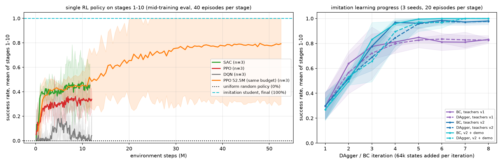
