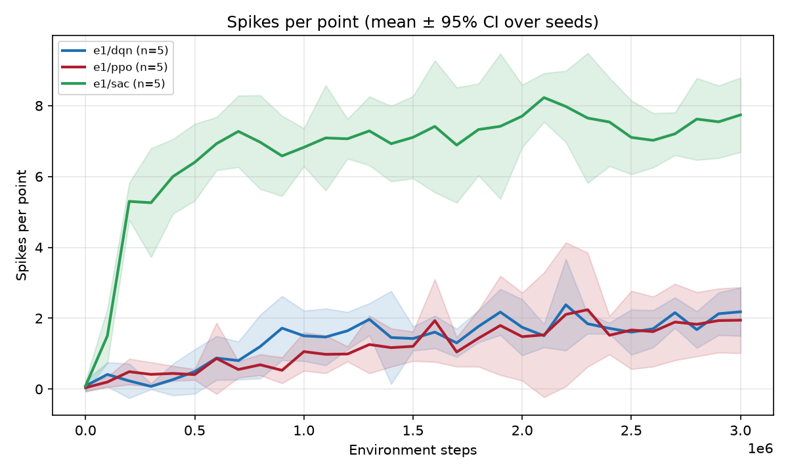
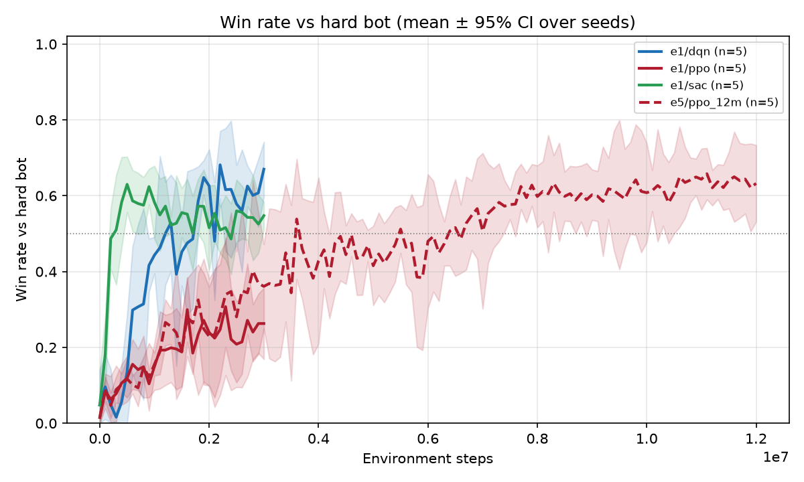

# 실험 결과

모든 수치는 **seed 5개의 평균 ± 95% 신뢰구간**(t 분포, 표본 단위는 학습 seed)이다. 학습은 i7-13700KF(CPU만 사용)에서 14개씩 동시에 돌렸고, 학습 시간은 그 조건에서 잰 값이다.

재현: `python -m experiments.final` (학습 80회 + 리그전 + 그래프, 약 5시간 30분)

## 평가 지표

- **봇 상대 승률**: 학습에 쓰지 않은 규칙 기반 봇(어려움)과 200점을 겨룬 승률. 학습 중 10만 스텝마다 측정했다.
- **리그전 Elo**: 학습이 끝난 모델 80개와 봇 3개가 서로 200점씩 겨룬 결과로 Bradley-Terry Elo를 계산했다. 어려움 봇을 1000점으로 맞췄다.
- **플레이 통계**: 어려움 봇과 겨룰 때 한 점당 스파이크·다이빙 횟수.

두 지표를 함께 쓰는 이유: 봇 상대 승률은 실력 변화를 고정된 잣대로 재지만 봇의 약점을 파고든 결과일 수 있다. 리그전은 학습된 에이전트끼리의 상대 비교라서 이를 보완한다.

## 전체 순위 (리그전 Elo)

| 순위 | 설정 | Elo | 어려움 봇 상대 승률 | 학습 시간(분) |
|---|---|---|---|---|
| 1 | PPO 1200만 스텝 (E5) | 1245 ± 35 | 0.63 ± 0.10 | 35 |
| 2 | SAC, 기본 행동 (E2) | 1129 ± 64 | 0.88 ± 0.10 | 138 |
| 3 | DQN (E1) | 1107 ± 38 | 0.67 ± 0.07 | 56 |
| 4 | DQN, epsilon 구간 0.1 (E7) | 1072 ± 99 | 0.55 ± 0.17 | 64 |
| 5 | DQN, epsilon 구간 0.5 (E7) | 1067 ± 57 | 0.61 ± 0.06 | 58 |
| 6 | SAC, 목표 엔트로피 0.5 (E6) | 1061 ± 48 | 0.57 ± 0.08 | 162* |
| 7 | SAC, 목표 엔트로피 0.1 (E6) | 1051 ± 41 | 0.59 ± 0.13 | 164* |
| 8 | DQN, 기본 행동 (E2) | 1046 ± 57 | 0.65 ± 0.14 | 65 |
| 9 | SAC (E1) | 1025 ± 51 | 0.55 ± 0.04 | 128 |
| - | 어려움 봇 | 1000 | - | - |
| 10 | PPO, self-play 0.9 (E8) | 946 ± 76 | 0.35 ± 0.14 | 9 |
| 11 | PPO, entropy 0 (E3) | 899 ± 157 | 0.28 ± 0.16 | 10 |
| 12 | PPO, 보조 보상 (E4) | 897 ± 73 | 0.32 ± 0.09 | 10 |
| - | 쉬움 봇 | 893 | - | - |
| 13 | PPO (E1) | 886 ± 22 | 0.26 ± 0.09 | 10 |
| 14 | PPO, 기본 행동 (E2) | 875 ± 44 | 0.42 ± 0.13 | 10 |
| 15 | PPO, self-play 0.3 (E8) | 860 ± 71 | 0.32 ± 0.16 | 9 |
| 16 | PPO, entropy 0.03 (E3) | 829 ± 67 | 0.19 ± 0.09 | 10 |
| - | 무작위 봇 | 503 | - | - |

\* E6는 무거운 SAC·DQN 14개를 동시에 돌려서 E1보다 느렸다. 설정 때문에 느려진 것이 아니다.

## E1 알고리즘 비교 (같은 300만 스텝)

| 알고리즘 | vs 무작위 | vs 쉬움 | vs 어려움 | 스파이크/점 | 다이빙/점 | 학습 시간(분) |
|---|---|---|---|---|---|---|
| DQN | 0.97 ± 0.01 | 0.77 ± 0.07 | **0.67 ± 0.07** | 2.18 ± 0.68 | 6.02 ± 3.38 | 56 |
| SAC | 0.97 ± 0.02 | 0.73 ± 0.06 | 0.55 ± 0.04 | 7.74 ± 1.05 | 0.71 ± 0.60 | 128 |
| PPO | 0.92 ± 0.02 | 0.41 ± 0.11 | 0.26 ± 0.09 | 1.95 ± 0.93 | 0.00 ± 0.00 | 10 |

seed별 어려움 봇 상대 승률: DQN 0.60 0.68 0.68 0.64 0.76 / SAC 0.52 0.54 0.55 0.55 0.59 / PPO 0.17 0.34 0.30 0.30 0.20

리그전 직접 대결 승률: DQN이 SAC를 0.64, PPO를 0.73으로 이기고, SAC가 PPO를 0.75로 이긴다.

관찰
- **같은 스텝에서는 DQN > SAC > PPO**이고, 봇 상대 승률과 리그전 순위가 일치한다.
- **SAC는 가장 빨리 배운다.** 20만 스텝에 어려움 봇 상대 승률 0.5에 도달하지만 이후 0.55 근처에서 멈춘다. DQN은 느리게 출발해서 150만 스텝 이후 SAC를 앞지른다.
- **seed 간 편차는 SAC가 가장 작다** (0.52~0.59). DQN과 PPO는 seed에 따라 결과가 크게 갈린다.
- **알고리즘마다 플레이 스타일이 다르다.** SAC는 점당 스파이크 7.7회로 공격 위주, DQN은 다이빙 6회로 수비 위주, PPO는 다이빙을 전혀 쓰지 않는다.

## E2 행동 공간 (확장 18개 vs 기본 6개)

기본 행동은 이동·점프만 남기고 스파이크·다이빙을 뺀 것이다.

| 알고리즘 | 확장 (vs 어려움) | 기본 (vs 어려움) | 리그전에서 기본이 확장을 이긴 비율 |
|---|---|---|---|
| SAC | 0.55 ± 0.04 | **0.88 ± 0.10** | 0.69 |
| DQN | 0.67 ± 0.07 | 0.65 ± 0.14 | 0.37 |
| PPO | 0.26 ± 0.09 | 0.42 ± 0.13 | (Elo 875 vs 886, 차이 없음) |

관찰
- **SAC는 행동을 줄이자 크게 좋아졌다.** 봇 상대 승률이 0.55에서 0.88로 오르고, 리그전에서도 확장 SAC를 0.69로 이긴다. 행동이 18개일 때는 스파이크를 남발하는 쪽으로 수렴한 것으로 보인다(점당 7.7회).
- **DQN은 반대다.** 봇 상대 승률은 같지만 리그전에서는 확장 DQN에 0.37로 진다. 봇은 스파이크·다이빙 없이도 이길 수 있지만, 그 기술을 쓰는 학습된 상대에게는 기술이 필요하다는 뜻이다.
- **봇 상대 승률과 리그전 결과가 엇갈리는 사례다.** 기본 SAC는 봇에게 0.88로 가장 강하지만 리그전에서는 DQN과 대등하다(0.47). 봇만으로 평가했다면 과대평가했을 것이다.

## E3 PPO entropy 계수 / E4 보조 보상

| PPO 설정 | vs 어려움 | Elo |
|---|---|---|
| entropy 0 | 0.28 ± 0.16 | 899 ± 157 |
| entropy 0.01 (기본) | 0.26 ± 0.09 | 886 ± 22 |
| entropy 0.03 | 0.19 ± 0.09 | 829 ± 67 |
| 보조 보상 +0.1 | 0.32 ± 0.09 | 897 ± 73 |

관찰
- **entropy 계수와 보조 보상은 의미 있는 차이를 만들지 못했다.** 신뢰구간이 모두 겹친다. entropy 0.03은 다소 나빠지는 경향만 보인다.
- entropy 0은 seed 하나(seed 4)가 크게 무너져서 신뢰구간이 넓다. 탐험이 없으면 결과가 불안정해진다.
- 즉 PPO의 약세는 이 하이퍼파라미터들 때문이 아니다.

## E5 같은 시간 비교 (PPO 1200만 스텝)

| 설정 | 스텝 | 학습 시간(분) | vs 어려움 | Elo |
|---|---|---|---|---|
| PPO | 300만 | 10 | 0.26 ± 0.09 | 886 ± 22 |
| **PPO** | **1200만** | **35** | 0.63 ± 0.10 | **1245 ± 35** |
| DQN | 300만 | 56 | 0.67 ± 0.07 | 1107 ± 38 |
| SAC | 300만 | 128 | 0.55 ± 0.04 | 1025 ± 51 |

관찰
- **PPO에 스텝을 4배 주면 리그전 1위가 된다.** DQN을 0.70, SAC를 0.82로 이긴다. 그래도 학습 시간은 DQN보다 짧다.
- PPO는 데이터를 한 번 쓰고 버리고, DQN·SAC는 리플레이 버퍼로 데이터를 여러 번 재사용한다. 그래서 **스텝 기준으로는 off-policy가 유리하고, 시간 기준으로는 PPO가 유리하다.**
- "어떤 알고리즘이 더 좋은가"의 답은 무엇을 같게 맞추느냐에 따라 뒤집힌다.

## E6 SAC 목표 엔트로피

SAC는 정책의 엔트로피가 목표값(비율 × log 행동 수)을 유지하도록 alpha를 자동으로 조절한다. 기본 비율은 0.3이다.

| SAC 설정 | vs 어려움 | 스파이크/점 | Elo | 리그전에서 기본 SAC를 이긴 비율 |
|---|---|---|---|---|
| 목표 엔트로피 0.1 | 0.59 ± 0.13 | 8.79 ± 3.59 | 1051 ± 41 | 0.53 |
| 목표 엔트로피 0.3 (기본) | 0.55 ± 0.04 | 7.74 ± 1.05 | 1025 ± 51 | - |
| 목표 엔트로피 0.5 | 0.57 ± 0.08 | 7.31 ± 0.99 | 1061 ± 48 | 0.51 |

관찰
- **목표 엔트로피는 결과를 거의 바꾸지 못했다.** 세 설정 모두 0.55~0.59에 머물고, 리그전 직접 대결도 0.5 근처다.
- 탐험을 줄이든(0.1) 늘리든(0.5) 스파이크 위주 플레이(점당 7~9회)는 그대로였다.
- 즉 확장 행동 SAC가 0.55에서 멈추는 원인은 탐험 정도가 아니다. E2에서 기본 행동으로 바꾸자 0.88이 된 것과 함께 보면, **행동 공간 자체**가 원인이라고 볼 수 있다.

## E7 DQN 탐험 기간

epsilon을 1.0에서 0.05로 줄이는 구간을 전체 학습의 10% / 30%(기본) / 50%로 바꿨다.

| DQN 설정 | vs 어려움 | seed별 값 | Elo | 리그전에서 기본 DQN을 이긴 비율 |
|---|---|---|---|---|
| 0.1 (짧게) | 0.55 ± 0.17 | 0.59 0.61 0.32 0.69 0.57 | 1072 ± 99 | 0.47 |
| 0.3 (기본) | 0.67 ± 0.07 | 0.60 0.68 0.68 0.64 0.76 | 1107 ± 38 | - |
| 0.5 (길게) | 0.61 ± 0.06 | 0.58 0.65 0.62 0.54 0.64 | 1067 ± 57 | 0.45 |

관찰
- **기본값 0.3이 가장 좋았지만, 차이는 신뢰구간 안이다.** 리그전 직접 대결도 0.45~0.47로 거의 대등하다.
- **탐험을 짧게 하면 불안정해진다.** 0.1에서는 seed 하나(seed 2)가 0.32로 무너져서 신뢰구간이 가장 넓다. E3의 PPO entropy 0과 같은 현상이다.
- 탐험을 길게 하면 seed 간 편차는 작아지지만 평균은 조금 낮다.

## E8 학습 상대 구성 (PPO)

학습 상대 중 과거 자신(self-play)의 비율을 바꿨다. 나머지는 쉬움 봇과 무작위 봇이 반씩 차지한다.

| PPO 설정 | 과거 자신 : 쉬움 : 무작위 | vs 어려움 | Elo |
|---|---|---|---|
| self-play 0.3 | 0.3 : 0.35 : 0.35 | 0.32 ± 0.16 | 860 ± 71 |
| self-play 0.6 (기본) | 0.6 : 0.2 : 0.2 | 0.26 ± 0.09 | 886 ± 22 |
| self-play 0.9 | 0.9 : 0.05 : 0.05 | 0.35 ± 0.14 | **946 ± 76** |

리그전 직접 대결: self-play 0.9가 기본을 0.63, self-play 0.3을 0.64로 이긴다.

관찰
- **봇 상대 승률로는 차이가 없지만, 리그전에서는 self-play 비율이 높을수록 강하다.** 어려움 봇 상대 승률은 세 설정 모두 신뢰구간이 겹친다. 반면 리그전에서는 0.9가 다른 두 설정을 0.63~0.64로 이긴다.
- self-play를 많이 하면 학습된 상대를 다루는 법을 더 배운다. 봇은 그 차이를 잡아내지 못하고, 리그전은 잡아낸다. E2의 SAC 사례와 같은 이유로 두 지표를 함께 봐야 한다.
- 다만 Elo 신뢰구간(946 ± 76, 860 ± 71)은 살짝 겹치므로 seed를 늘려 확인할 필요가 있다.

## 토의

1. **비교 기준의 선택이 결론을 바꾼다.** 같은 스텝이면 DQN, 같은 시간이면 PPO가 가장 강하다. 시뮬레이터가 빠른 환경에서는 PPO, 데이터 수집이 비싼 환경(실제 로봇 등)에서는 DQN·SAC가 유리하다고 해석할 수 있다.
2. **행동이 많다고 좋은 게 아니다.** SAC는 기술이 없는 기본 행동에서 오히려 훨씬 강했다. 반면 DQN은 기술이 있어야 학습된 상대를 이겼다. 같은 환경 변화가 알고리즘마다 반대로 작용했다.
3. **평가 상대가 하나면 위험하다.** 기본 SAC는 봇 기준으로는 압도적이지만 리그전 기준으로는 DQN과 비슷했다. 고정 봇과 리그전을 함께 써야 결론을 믿을 수 있다.
4. **알고리즘마다 고유한 플레이 스타일이 생겼다.** 최대 엔트로피를 추구하는 SAC는 공격적인 스파이크, 가치 기반인 DQN은 다이빙 수비 위주였다. SAC의 스파이크 위주 스타일은 목표 엔트로피를 바꿔도 유지됐다(E6).
5. **하이퍼파라미터보다 구조적 선택의 영향이 컸다.** 세 알고리즘의 주요 탐험 하이퍼파라미터(PPO entropy, SAC 목표 엔트로피, DQN epsilon 구간)는 모두 신뢰구간 안의 차이만 만들었다. 반면 학습량(E5)과 행동 공간(E2)은 결과를 크게 바꿨고, 학습 상대(E8)도 리그전 순위를 바꿨다.
6. **탐험이 부족하면 seed 하나가 무너진다.** PPO entropy 0(E3)과 DQN epsilon 구간 0.1(E7)에서 각각 seed 하나가 크게 실패했다. 평균보다 seed 간 편차에서 탐험의 역할이 드러났다.

## 한계와 개선 방향

- **하이퍼파라미터는 알고리즘마다 탐험 관련 값 하나씩만 조정했다.** 학습률, 네트워크 크기 등은 세 알고리즘 모두 기본값이다.
- **E5는 PPO에만 스텝을 늘렸다.** DQN·SAC도 같은 시간(35분, 2시간 등)을 맞춘 비교가 더 정확하다.
- **seed 5개는 작은 표본이다.** 신뢰구간이 넓은 설정(E3 entropy 0 등)은 seed를 늘려야 결론을 낼 수 있다.
- **봇은 직접 만든 규칙이라 약점이 있다.** 리그전으로 보완했지만, 사람 플레이어와의 대결 같은 외부 기준이 있으면 더 좋다.
- **학습 상대 구성(E8)은 PPO에서만 바꿔 봤다.** DQN·SAC에서도 같은 경향인지는 확인하지 않았다.
